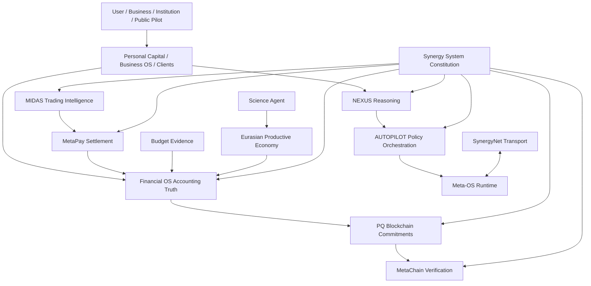

# СИНЕРГИЯ — Regulatory Sandbox / Verifiable Economic Coordination OS

> **Master-dossier проекта для регуляторной песочницы, грантов, технологических партнёров и инвесторов.**  
> **Статус:** R&D / pre-production / sandbox proposal  
> **Дата среза:** 6 сентября 2026  
> **Архитектурный корень:** `Shtenco/synergy_system`  
> **Федерация:** 45 репозиториев  
> **Основатель и системный архитектор:** Евгений Коштенко

---

## 1. Executive summary

**СИНЕРГИЯ** — проект регуляторной песочницы для проверки федеративной цифровой экономической инфраструктуры, объединяющей личные финансы, бизнес, институциональные инвестиции, платежи, бухгалтерскую истину, государственные расходы, научные проекты, промышленность, AI-координацию, распределённую сеть и post-quantum trust.

Главная инженерная идея:

> **один экономический факт → один источник полномочий → типизированный контракт → проверяемое доказательство → воспроизводимый маршрут между независимыми системами.**

СИНЕРГИЯ не предполагает, что AI, blockchain, token mint/rebase или внутренняя переоценка сами по себе создают экономическую ценность. Внешняя прибыль признаётся только после внешнего settlement и reconciliation; бухгалтерская истина принадлежит Financial OS; платёжный settlement — MetaPay; trading intelligence — MIDAS; reasoning — NEXUS; blockchain/metachain фиксируют и проверяют commitments, но не подменяют реальный мир и бухгалтерию.

Цель песочницы — **доказать или опровергнуть** технологические, экономические и регуляторные гипотезы проекта ограниченными пилотами до масштабирования.

---

## 2. Что проверяется в песочнице

### Pilot A — «Личный капитал»

Не-кастодиальное приложение финансовой дисциплины:

- `Доходы − Расходы = Дельта`;
- бюджетные конверты и цели;
- резерв 3–6 месяцев;
- долговой модуль;
- инвестиционная лестница;
- compound-capital / financial-freedom scenarios;
- stress testing;
- AI-помощник с ограниченной authority.

**KPI:** savings rate, reserve months, debt-service burden, устойчивость бюджета, качество risk understanding.

### Pilot B — MetaPay + Financial OS

Регулируемый контур платежа и бухгалтерской истины:

`PaymentIntent → FundingReservation → Execution → SettlementEvidence → Reconciliation → Double Entry → Financial Close → Reversal/Compensation`.

**KPI:** полный audit trail, отсутствие двойного признания, settlement-backed PnL, корректные HardNAV/liquidity/liabilities.

### Pilot C — MIDAS Institutional Capital Engine

- multi-model market intelligence;
- global capacitated liquidity graph;
- OOS / walk-forward / shadow validation;
- costs/slippage/market impact/capacity;
- bounded `TradingExecutionIntent`;
- признание PnL только после settlement + reconciliation.

**KPI:** наличие/отсутствие устойчивого внешнего edge после всех расходов. До получения требуемых разрешений live-торговля клиентскими средствами не является частью базового sandbox perimeter.

### Pilot D — Blockchain Budget / Public Finance Evidence

- budget/procurement/payment/delivery traceability;
- Merkle evidence;
- anomaly detection;
- MOCK vs realized evidence separation;
- audit-time / error / loss-prevention measurement.

### Pilot E — Federation V3 Secure Event Fabric

- immutable typed contracts;
- signed event envelopes;
- transactional outbox/inbox;
- persistent replay ledger;
- delivery leases/recovery;
- at-least-once + idempotent consumption;
- DLQ / quarantine;
- compensating flows;
- SynergyNet store-forward;
- Meta-OS orchestration without financial authority;
- PQ signature provider boundary.

### Pilot F — Science → Falsification → Industry

`Hypothesis → Simulation → Falsification → Experiment → Reproduction → TRL → IP → Commercialization → Industrial Project`.

Scientific hypothesis is never promoted to scientific truth without reproducible evidence.

---

## 3. Почему нужна регуляторная песочница

СИНЕРГИЯ пересекает платежи, инвестиции, algorithmic trading, digital assets, accounting, AI-assisted decisions, public finance, identity/data и cross-border interoperability.

Песочница позволяет отдельно проверить:

1. **Technology** — contracts, event delivery, failure recovery, reconciliation.
2. **Economics** — создаётся ли внешняя ценность после расходов.
3. **Risk** — replay, crash, reversal, liquidity stress, key compromise.
4. **Compliance** — KYC/AML, licensed partner boundaries, data handling, approvals.
5. **Consumer protection** — отсутствие скрытых гарантий доходности и смешения средств.
6. **Scalability** — переход от одного пилота к федерации независимых доменов.

### Sandbox perimeter

По умолчанию: synthetic/mock funds, testnet, shadow/paper execution, limited datasets. Реальные клиентские средства, regulated instruments или внешнее payment execution включаются только при соответствующем правовом основании и/или через лицензированного партнёра.

---

## 4. Архитектура



### One authority per fact

| Факт / полномочие | Канонический владелец |
|---|---|
| Architecture / constitution / authority / evidence registry | `synergy_system` |
| Runtime orchestration | `synergy_meta_os` |
| P2P transport | `synergynet` |
| Reasoning | `agi_nexus` |
| Action/policy orchestration | `agi_autopilot` |
| Trading intelligence | `midas_ai` |
| Payment execution / settlement | `synergy_pay_system` |
| Accounting truth / HardNAV | `synergy_financial_os` |
| PQ commitments | `synergy_ai_blockchain` |
| Cross-chain verification | `synergy_metachain` |
| Budget/procurement traceability | `blochain_budget` |
| Household product | `synergy_app` |
| Productive economy | `synergy_eurasian` |
| Science workflow | `nexus_science_agent` |

---

## 5. Secure Event Fabric

```text
Validated Contract
      ↓
Signed Immutable Event Envelope
      ↓
Transactional Outbox
      ↓
SynergyNet Store-Forward
      ↓
Persistent Inbox + Replay Ledger
      ↓
Domain Consumer
      ↓
ACK / Retry / DLQ / Quarantine / Compensation
```

### Invariants

- `at-least-once delivery + idempotent consumer`;
- same `contract_id` + different hash/type/route = conflict, not harmless duplicate;
- retry does not mutate signed economic fact;
- reversal creates a new append-only fact;
- payment/accounting truth and outbox event commit atomically inside each domain;
- transport has no financial authority;
- Meta-OS has no payment/accounting authority;
- blockchain does not recompute HardNAV.

### PQ security

Primary R&D profile: ML-DSA; SLH-DSA is a heavier backup profile. Production private-key custody must move to dedicated HSM/KMS/key-registry boundaries; process-local keys are not production custody.

---

## 6. Economic truth firewall

> **No external settlement ⇒ no external profit.**

Not external profit by itself:

- mint/rebase;
- internal token mark;
- transfer between own accounts/reserves;
- flash-loan principal;
- own LP revaluation;
- backtest without OOS/cost/capacity;
- scenario AI uplift;
- new participant contribution;
- unverified scientific claim.

Canonical value chain:

`real demand → verified transaction/project → settlement → reconciliation → recognized revenue/PnL → reserves/liabilities → distributable capacity → reinvestment`.

---

## 7. Product domains

### Personal Capital

`Income − Expenses = Delta → Investment → Assets → Net Capital → Financial Freedom`, дополнено reserve/debt/stress/scenario engines.

### Business / Growth OS

Network/franchise/referral mechanics допускаются только если economic reward связан с real sale/service/economic contribution.

> `recruitment ≠ revenue`

### Financial OS / Development Fund

- liquidity buckets;
- liabilities;
- reserves;
- project allocations;
- realized external PnL;
- distribution capacity;
- replay/restatement/reversal;
- audit trail.

### MetaPay

Разделяет `unit_of_account`, `payment_asset`, `reserve_asset`, `risk/growth_asset`, а также routing, funding, settlement и reconciliation.

### MIDAS

Institutional intelligence layer, не гарантия доходности.

### Budget Blockchain

Blockchain — evidence/commitment layer, не замена первичным документам, treasury или accounting.

### Science & Industry

Research results проходят falsification/reproduction/TRL gates перед productive-project financing.

---

## 8. Current engineering status

**Production-ready статус не заявляется.**

| Контур | Статус на 06.09.2026 |
|---|---|
| Federation V3 / 45 repo authority map | implemented candidate / open federation work |
| Contracts V1 | typed schemas + runtime types + negative tests |
| Secure Event Fabric | outbox/inbox/replay/DLQ/quarantine/lease recovery candidate |
| SynergyNet | durable opaque store-forward transport candidate |
| Meta-OS | persistent routing/replay candidate |
| MetaPay | settlement + transactional outbox candidate |
| Financial OS | accounting/HardNAV + transactional outbox candidate |
| AI Blockchain | typed PQ commitments / ML-DSA R&D candidate |
| MetaChain | finality/light-client/bridge-proof contract layer candidate |
| MIDAS | canonical target + large institutional R&D lineage |
| NEXUS / AUTOPILOT | bounded reasoning/control R&D |
| Personal Capital | canonical product target |
| Budget | public-finance traceability target |
| Science Agent | falsification→TRL→commercialization target |
| XPU / TURBO | compute/host R&D |

### Current evidence boundary

Reference E2E covers:

`MIDAS → MetaPay → Financial OS → Blockchain → MetaChain`.

Next proof target: **literal multi-repo / multi-process E2E with native checkouts**. Until then the correct status remains pre-production/sandbox R&D.

---

# 9. Полная открытая карта 45/45 репозиториев + оценка IP

Ниже нет скрытого `<details>`: инвестор/грантовый эксперт видит весь портфель сразу.

**Все цифры — USD millions.**  
`Replacement` = ориентир стоимости воспроизведения.  
`Current IP` = внутренняя risk-adjusted оценка технологии/know-how сегодня.  
`Post-sandbox` = сценарная option value после evidence gates, **не сегодняшняя цена**.

| # | Repo | Класс / роль | Replacement | Current IP | Post-sandbox |
|---:|---|---|---:|---:|---:|
| 1 | [shtenco.github.io](https://github.com/Shtenco/shtenco.github.io) | PUBLIC_PROVENANCE / presentation | 0.03–0.08 | 0.02–0.06 | 0.03–0.10 |
| 2 | [quantum-trading_metatrader5](https://github.com/Shtenco/quantum-trading_metatrader5) | LEGACY_R&D / trading experiment | 0.08–0.20 | 0.05–0.15 | 0.10–0.30 |
| 3 | [computer_vision_trading_metatrader_5](https://github.com/Shtenco/computer_vision_trading_metatrader_5) | R&D_SOURCE / CV market representation | 0.10–0.25 | 0.07–0.20 | 0.15–0.40 |
| 4 | [swap_arbitrage_metatrader_5](https://github.com/Shtenco/swap_arbitrage_metatrader_5) | R&D_SOURCE / carry-swap research | 0.08–0.20 | 0.05–0.15 | 0.10–0.30 |
| 5 | [cross_forex_arbitrage_trading_metatrader_5](https://github.com/Shtenco/cross_forex_arbitrage_trading_metatrader_5) | R&D_SOURCE / cross-rate graph arbitrage | 0.10–0.25 | 0.07–0.20 | 0.15–0.40 |
| 6 | [global_liquidity_dataminer](https://github.com/Shtenco/global_liquidity_dataminer) | R&D_SOURCE / liquidity-macro features | 0.10–0.30 | 0.08–0.25 | 0.20–0.60 |
| 7 | [3D_bars_market_structure](https://github.com/Shtenco/3D_bars_market_structure) | R&D_SOURCE / volume-time-price structure | 0.12–0.35 | 0.10–0.30 | 0.25–0.70 |
| 8 | [multi_threaded_trading_robot_with_machine_learning_python](https://github.com/Shtenco/multi_threaded_trading_robot_with_machine_learning_python) | R&D_SOURCE / parallel ML trading | 0.15–0.40 | 0.10–0.30 | 0.20–0.60 |
| 9 | [midas_ai_trading_system](https://github.com/Shtenco/midas_ai_trading_system) | R&D_SOURCE / institutional MIDAS lineage | 0.60–1.50 | 0.45–1.20 | 1.20–3.00 |
| 10 | [midas_lite](https://github.com/Shtenco/midas_lite) | LEGACY_SOURCE / compact MIDAS | 0.08–0.20 | 0.04–0.12 | 0.08–0.20 |
| 11 | [turbo_linux](https://github.com/Shtenco/turbo_linux) | ACTIVE_R&D_TARGET / host-runtime | 0.50–1.50 | 0.35–1.20 | 1.00–3.00 |
| 12 | [agi_olga](https://github.com/Shtenco/agi_olga) | ACTIVE_R&D_SOURCE / OLGA→NEXUS lineage | 0.80–2.00 | 0.60–1.50 | 1.50–4.00 |
| 13 | [ai_coder](https://github.com/Shtenco/ai_coder) | ENGINEERING_CONTROL / change evidence | 0.15–0.40 | 0.10–0.30 | 0.30–0.80 |
| 14 | [ai_trade_terminal](https://github.com/Shtenco/ai_trade_terminal) | LEGACY_SOURCE / trading terminal | 0.15–0.35 | 0.08–0.25 | 0.20–0.60 |
| 15 | [shtencoauantai.github.io](https://github.com/Shtenco/shtencoauantai.github.io) | PUBLIC_PROVENANCE / quant-AI showcase | 0.05–0.15 | 0.03–0.10 | 0.05–0.20 |
| 16 | [cashero](https://github.com/Shtenco/cashero) | LEGACY_TOKENOMIC_R&D | 0.10–0.30 | 0.05–0.20 | 0.10–0.40 |
| 17 | [ai_language](https://github.com/Shtenco/ai_language) | ENGINEERING_CORE / semantic requirements | 0.40–1.00 | 0.30–0.80 | 1.00–2.50 |
| 18 | [sinergy-super-app](https://github.com/Shtenco/sinergy-super-app) | APPLICATION_CLIENT / super-app lineage | 0.20–0.60 | 0.10–0.40 | 0.40–1.20 |
| 19 | [binary_quantum_theory](https://github.com/Shtenco/binary_quantum_theory) | SCIENTIFIC_R&D / candidate physics framework | 0.40–1.20 | 0.20–0.80 | 0.80–3.00 |
| 20 | [ai_financial_system](https://github.com/Shtenco/ai_financial_system) | R&D_SOURCE / AMM-QE-QT-MEV | 0.50–1.20 | 0.30–0.90 | 0.80–2.50 |
| 21 | [algotrading_graph_system](https://github.com/Shtenco/algotrading_graph_system) | R&D_TARGET / global capacitated market graph | 0.10–0.30 | 0.08–0.25 | 0.40–1.20 |
| 22 | [ai_compress](https://github.com/Shtenco/ai_compress) | ENGINEERING_CORE / compression-dedup | 0.20–0.60 | 0.15–0.45 | 0.50–1.50 |
| 23 | [synergy_pay_system](https://github.com/Shtenco/synergy_pay_system) | CANONICAL_DOMAIN / MetaPay | 0.70–1.80 | 0.60–1.50 | 2.00–5.00 |
| 24 | [synergy_ai_blockchain](https://github.com/Shtenco/synergy_ai_blockchain) | CANONICAL_TARGET / PQ trust | 0.70–1.80 | 0.55–1.40 | 2.00–5.00 |
| 25 | [synergychain](https://github.com/Shtenco/synergychain) | APPLICATION_CONTROL_PLANE / Business OS | 0.50–1.30 | 0.40–1.00 | 1.50–4.00 |
| 26 | [synergychain.github.io](https://github.com/Shtenco/synergychain.github.io) | PRESENTATION / public portal | 0.08–0.20 | 0.05–0.12 | 0.10–0.30 |
| 27 | [cold_nuclear](https://github.com/Shtenco/cold_nuclear) | SCIENTIFIC_R&D / LENR-transmutation | 0.20–0.70 | 0.08–0.40 | 0.50–3.00 |
| 28 | [usds](https://github.com/Shtenco/usds) | MONETARY_R&D / stable-money research | 0.15–0.40 | 0.08–0.25 | 0.20–0.80 |
| 29 | [synergy_financial_os](https://github.com/Shtenco/synergy_financial_os) | CANONICAL_TARGET / accounting truth | 0.90–2.30 | 0.80–2.00 | 3.00–8.00 |
| 30 | [synergy_eurasian](https://github.com/Shtenco/synergy_eurasian) | CANONICAL_DOMAIN_TARGET / productive economy | 0.40–1.20 | 0.30–1.00 | 1.50–5.00 |
| 31 | [synergy_matrix_sota](https://github.com/Shtenco/synergy_matrix_sota) | CANONICAL_DOMAIN_TARGET / household model | 0.20–0.60 | 0.15–0.45 | 0.50–1.50 |
| 32 | [agi_nexus](https://github.com/Shtenco/agi_nexus) | CANONICAL_TARGET / bounded reasoning | 0.90–2.50 | 0.70–2.00 | 3.00–8.00 |
| 33 | [midas_ai](https://github.com/Shtenco/midas_ai) | CANONICAL_TARGET / institutional trading intelligence | 0.90–2.50 | 0.80–2.20 | 3.00–8.00 |
| 34 | [synergy_system](https://github.com/Shtenco/synergy_system) | CANONICAL_ROOT / federation constitution | 0.80–2.20 | 0.70–1.80 | 3.00–7.00 |
| 35 | [nexus_science_agent](https://github.com/Shtenco/nexus_science_agent) | CANONICAL_TARGET / science workflow | 0.30–0.90 | 0.25–0.70 | 1.00–3.00 |
| 36 | [synergynet](https://github.com/Shtenco/synergynet) | CANONICAL_TARGET / P2P evidence transport | 0.60–1.60 | 0.50–1.30 | 2.00–5.00 |
| 37 | [synergy_meta_os](https://github.com/Shtenco/synergy_meta_os) | CANONICAL_TARGET / runtime orchestration | 0.50–1.40 | 0.40–1.10 | 1.50–4.00 |
| 38 | [blochain_budget](https://github.com/Shtenco/blochain_budget) | CANONICAL_DOMAIN_TARGET / GovTech evidence | 0.40–1.20 | 0.30–0.90 | 1.50–5.00 |
| 39 | [agi_autopilot](https://github.com/Shtenco/agi_autopilot) | CANONICAL_TARGET / bounded action orchestration | 0.50–1.50 | 0.40–1.20 | 2.00–6.00 |
| 40 | [sinergy_app](https://github.com/Shtenco/sinergy_app) | LEGACY_PLACEHOLDER | 0.01–0.03 | 0.00–0.02 | 0.00–0.05 |
| 41 | [synergy_app](https://github.com/Shtenco/synergy_app) | CANONICAL_PRODUCT_TARGET / Personal Capital | 0.30–0.90 | 0.25–0.70 | 1.00–3.00 |
| 42 | [qr_compress](https://github.com/Shtenco/qr_compress) | R&D_TARGET / offline compact payloads | 0.15–0.45 | 0.10–0.35 | 0.40–1.20 |
| 43 | [synergy_metachain](https://github.com/Shtenco/synergy_metachain) | CANONICAL_TARGET / cross-chain verification | 0.50–1.40 | 0.40–1.10 | 1.50–4.00 |
| 44 | [motherboard_xpu_xml](https://github.com/Shtenco/motherboard_xpu_xml) | ACTIVE_R&D_TARGET / compiled-graph XPU | 0.80–2.50 | 0.60–2.00 | 2.50–8.00 |
| 45 | [print_money_synergychain](https://github.com/Shtenco/print_money_synergychain) | FALSIFICATION_R&D / HardNAV-profit firewall | 0.20–0.60 | 0.10–0.40 | 0.30–1.00 |

**45 / 45 repositories listed.**

Подробный due-diligence annex: [`IP_VALUATION.md`](./IP_VALUATION.md).  
Открытый repo-only registry: [`REPOSITORIES.md`](./REPOSITORIES.md).

---

# 10. IP / technology / know-how valuation

## 10.1 Методология

Для раннего technology/IP portfolio используется гибридная логика, соответствующая базовым подходам WIPO:

1. **Cost / replacement / reproduction approach** — главный baseline для pre-revenue technology.
2. **Market/comparable approach** — sanity-check, когда существуют сопоставимые сделки.
3. **Income approach** — применим только к отделимым и реалистично прогнозируемым cash flows.
4. **Real-options approach** — полезен для R&D, где стоимость раскрывается по мере снятия технических/регуляторных рисков.

WIPO отдельно подчёркивает, что стоимость ранней IP контекстна, зависит от maturity, uncertainty, future economic benefits и не равна transaction price.

### What is included

- source code;
- architecture;
- algorithms;
- mathematical models;
- model/benchmark lineage;
- data schemas and typed contracts;
- test/failure/recovery semantics;
- product/process know-how;
- experimental protocols;
- accumulated negative results and engineering decisions;
- transfer/documentation value where present.

### What is not automatically included

- valuation of the legal entity/company;
- future revenue that has not been earned;
- brand goodwill not independently valued;
- customer contracts that do not exist;
- regulatory approvals not yet obtained;
- patents not yet granted;
- unverified scientific claims;
- simulated trading PnL.

## 10.2 Gross repo-level sum

Mechanical sum of 45 repo bands:

- **Replacement / reproduction:** **$15.7–43.3M**;
- **Current risk-adjusted IP/know-how:** **$11.9–34.0M**;
- **Post-sandbox option scenario:** **$43.5–123.4M**.

## 10.3 Portfolio overlap adjustment

Repo-level sums double-count shared know-how and lineage. Для conservative portfolio view применяется внутренний **25% overlap/correlation haircut**.

После haircut:

> **Indicative replacement/reproduction portfolio: $11.8–32.5M.**

> **Current indicative technology/IP/know-how portfolio: $8.9–25.5M.**

> **Post-sandbox option portfolio: $32.6–92.5M.**

Для презентации можно округлять:

> **Текущая внутренняя оценка IP/know-how СИНЕРГИИ: ~$9–26M.**

Это **не independent appraisal, не audited fair value и не offer price**.

## 10.4 Cluster valuation — gross before overlap haircut

| Technology cluster | Replacement | Current IP | Post-sandbox option |
|---|---:|---:|---:|
| Core financial / trust / network | $5.2–14.0M | $4.35–11.4M | $17.0–44.0M |
| AI / engineering | $2.55–6.8M | $1.95–5.3M | $6.8–18.3M |
| Trading / market intelligence | $2.56–6.8M | $1.97–5.57M | $6.03–16.3M |
| Product / economy / GovTech | $2.0–5.8M | $1.5–4.45M | $6.4–19.7M |
| Compute / data | $1.65–5.05M | $1.2–4.0M | $4.4–13.7M |
| Monetary / financial R&D | $0.95–2.5M | $0.53–1.75M | $1.4–4.7M |
| Scientific R&D | $0.6–1.9M | $0.28–1.2M | $1.3–6.0M |
| Presentation / legacy client | $0.17–0.46M | $0.10–0.30M | $0.18–0.65M |

## 10.5 Highest-value know-how blocks

### Federation authority / evidence architecture

- one-authority-per-fact;
- producer/consumer contracts;
- provenance + causation;
- release/evidence ladder;
- negative authority tests;
- separation of reasoning, settlement, accounting and trust.

### Financial OS

- HardNAV vs internal mark;
- external-settlement-before-profit;
- double-entry economic truth;
- distributable capacity;
- reversal/restatement;
- settlement-backed PnL;
- accounting commitments.

### MetaPay

`Intent → FundingReservation → Execution → SettlementEvidence → Reconciliation → Receipt → Reversal`.

### MIDAS

- multi-model institutional architecture;
- feature/validation lineage;
- OOS/walk-forward discipline;
- cost/capacity sensitivity;
- portfolio/risk modelling;
- global-liquidity graph;
- accumulated successful and failed experiments.

### NEXUS + AUTOPILOT

- explicit UNKNOWN;
- provenance;
- typed graph semantics;
- reasoning ≠ authorization;
- capability/policy gates;
- human escalation;
- no direct financial authority.

### Secure Event Fabric

- signed immutable envelope;
- outbox/inbox;
- persistent replay ledger;
- conflicting replay rejection;
- delivery lease recovery;
- DLQ/quarantine;
- compensation instead of history rewrite;
- PQ signer boundary.

### PQ Blockchain + MetaChain

- typed commitments;
- ML-DSA integration R&D;
- accounting/trust separation;
- light-client/finality/bridge-proof contracts;
- future key rotation/revocation architecture.

### XPU + TURBO

- compiled graph execution;
- global wavefront placement;
- `chiplet→cluster→tile→lane→cycle` mapping;
- switch/time-slot reservation;
- host/runtime/virtualization architecture.

### Budget / GovTech

- budget→procurement→payment→delivery causal trace;
- Merkle evidence;
- anomaly modelling;
- mock-vs-real outcome separation;
- public-sector ROI methodology.

### Science-to-industry process IP

`Hypothesis → Falsification → Experiment → Reproduction → TRL → IP → Commercialization`.

## 10.6 What can increase valuation materially

- literal native multi-repo E2E;
- independent security review;
- HSM/KMS/key lifecycle;
- regulatory sandbox approval/partner;
- repeatable paying customers;
- audited revenue attribution;
- live-settled MIDAS evidence after costs;
- measured GovTech pilot impact;
- measurable Personal Capital cohort outcomes;
- production SynergyNet benchmarks;
- XPU FPGA/emulation/silicon evidence;
- granted/strategically filed patents with clean title;
- licensed datasets/model artifacts with clear rights.

## 10.7 What can reduce valuation

- unclear code/IP ownership;
- contractor code without assignment;
- incompatible OSS licenses;
- leaked credentials/private keys;
- unreproducible results;
- working code only in non-canonical branches;
- missing CI/tests;
- scientific overclaim;
- trading claims without settlement evidence;
- single-person dependency without transfer documentation;
- lack of buyer/customer validation.

## 10.8 IP due diligence required before formal appraisal

1. Formal `IP_REGISTER` for 45 repositories.
2. Contributor/contractor chain-of-title evidence.
3. SBOM / OSS-license audit.
4. Classification: copyright / trade secret / patent candidate / dataset / model / trademark / process know-how.
5. Prior-art search and patentability review.
6. Secret remediation and key-rotation evidence.
7. Exact valuation commit/hash per repo.
8. Reproduction-cost worksheets.
9. Market comparables where transaction data exists.
10. Income valuation only after separable cash flows exist.
11. Independent valuation before audited accounts, collateral, M&A or formal fair-value claims.

---

## 11. Regulatory & compliance-by-design

Fail-closed: absence of evidence is not permission.

- KYC/KYB and AML/CFT where applicable;
- segregation of own/client funds;
- human/multisig critical approvals;
- suitability/risk disclosure;
- model-risk management;
- data minimization/consent/retention/access control;
- incident response and key rotation/revocation;
- independent security review before production;
- licensed broker/payment/custody partner where required;
- no guaranteed-return marketing;
- explicit `MOCK / SCENARIO / SHADOW / LIVE_SETTLED` labels.

### AI authority boundary

AI may analyze, rank, simulate, detect anomalies and propose actions.

AI may not by default:

- recognize accounting profit;
- sign payments;
- control client assets;
- change authority policy;
- declare a hypothesis scientifically proven;
- self-promote the system to production-ready.

---

## 12. 18-month sandbox roadmap

### Phase 0 — 0–2 months

- jurisdiction/sandbox perimeter;
- legal mapping;
- threat model;
- KPI baseline;
- partner roles;
- protocol freeze.

### Phase 1 — 2–6 months

- synthetic/testnet funds;
- literal multi-repo E2E;
- persistent PQ key registry;
- failure injection;
- reversal/reconciliation tests;
- regulator/auditor read-only dashboard.

### Phase 2 — 6–12 months

- controlled users/organizations;
- non-custodial Personal Capital;
- shadow MIDAS;
- sandbox MetaPay via partner/model rails;
- budget/procurement pilot;
- security/model-risk audit.

### Phase 3 — 12–18 months

- KPI vs baseline/control;
- promote only modules that pass gates;
- limited live-settled operations where legally permitted;
- commercialization package;
- production architecture decision.

---

## 13. Sandbox KPI

### Technology

- 0 lost committed events;
- 0 duplicate domain effects under redelivery;
- 100% conflicting-replay detection in test corpus;
- crash recovery;
- complete provenance chain rate;
- RTO/RPO by authority domain.

### Finance

- 100% live PnL backed by settlement + reconciliation;
- `HardNAV delta = reconciled external result` for matched transactions;
- no distribution beyond verified capacity;
- liquidity/reserve coverage.

### Consumer

- savings rate;
- reserve months;
- debt-service burden;
- risk-disclosure comprehension;
- complaint/error/override rates.

### Public finance

- fully traceable case share;
- audit time;
- confirmed anomalies;
- verified prevented/recovered loss.

### AI

- selective-answer accuracy;
- UNKNOWN quality;
- provenance completeness;
- false-positive/false-negative rate;
- human override rate;
- accepted prohibited authority escalations = 0.

### Science/industry

- falsified/validated hypotheses;
- reproducible experiments;
- TRL transitions;
- IP artifacts;
- industrial pilots;
- external revenue from commercialized results.

---

## 14. Business model after sandbox

1. **B2C SaaS** — Personal Capital.
2. **B2B SaaS/API** — Financial OS / Business OS / evidence APIs.
3. **B2B2C infrastructure** — MetaPay through licensed partners.
4. **Institutional licensing** — MIDAS analytics/risk tooling.
5. **GovTech** — budget/procurement traceability.
6. **Enterprise infrastructure** — Secure Event Fabric / federation tooling.
7. **R&D commercialization** — licensing, IP, spin-outs, industrial projects.

Trading returns are not guaranteed project revenue.

---

## 15. Funding request

### Regulatory/institutional partner

Sandbox perimeter, compliance requirements, KPI supervision, permissioned pilot path.

### Grant partner

Funding tied to measurable deliverables: E2E reliability, security, GovTech pilot, science-to-industry reproducibility, independent validation.

### Strategic/venture investor

Capital goes to productizing evidence-backed modules rather than financing unverified claims.

### Indicative use of funds

- **30%** engineering / multi-repo E2E / reliability;
- **20%** compliance / legal / security audit;
- **15%** pilot infrastructure/data;
- **15%** productization/UX;
- **10%** independent validation/science reproducibility;
- **10%** commercialization/IP/partner integrations.

---

## 16. Milestone-based financing

| Gate | Deliverable | Capital opens if… |
|---|---|---|
| G0 | architecture + legal perimeter | authorities/KPI/risks defined |
| G1 | closed E2E sandbox | native multi-process trace reproducible |
| G2 | security/compliance validation | no unresolved critical findings |
| G3 | controlled pilot | KPI show measurable effect |
| G4 | limited live-settled | results confirmed by settlement/accounting |
| G5 | commercialization | buyer/use case + unit economics exist |

---

## 17. Key risks

| Risk | Mitigation |
|---|---|
| Scope too broad | independent pilots/gates |
| Regulatory uncertainty | sandbox-first + licensed partners |
| Internal-metric illusion | HardNAV + settlement firewall |
| Model overfit | OOS/walk-forward/shadow/live evidence |
| AI authority creep | authority registry + negative tests |
| Event loss/duplication | outbox/inbox + replay/idempotency |
| Key compromise | PQ provider + rotation + HSM/KMS path |
| Blockchain as truth oracle | commitment layer only |
| Scientific overclaim | falsification/reproduction/TRL |
| MLM/network risk | recruitment-funded economics rejected |
| Exponential-growth narrative | capacity/saturation/system dynamics |
| Multi-repo complexity | typed contracts + federation root |

---

## 18. Historical origin and modernization

Conceptual lineage began in 2018 and by 2025 connected personal capital, consortium/fund, science, industry, AI and digital monetary/payment systems.

Federation V3 preserves long-horizon coordination and science→industry feedback but does **not** preserve historical assumptions as facts.

Not canonical truth:

- guaranteed yields;
- fixed AI uplift percentages;
- unconstrained exponential growth;
- recruitment-funded economics;
- internal token price as external wealth;
- unverified science;
- blockchain accounting authority;
- unrestricted AI executive authority.

These can exist only as `HYPOTHESIS / SCENARIO / R&D` until re-earned by evidence.

---

## 19. Research tracks

### Financial / market
capacitated liquidity graph, FX routing, market making, settlement-aware arbitrage, portfolio/risk intelligence, AMM/QE/QT/MEV falsification.

### AI
bounded NEXUS, typed graph semantics, UNKNOWN, provenance, policy/action orchestration, semantic requirements, AI engineering evidence.

### Trust / security
ML-DSA/SLH-DSA, signed contracts, durable transport, cross-chain verification, offline evidence payloads.

### Compute
TURBO, XPU, global wavefront placement, compression/dedup/content archive.

### Science
fundamental models, LENR/transmutation as hypotheses, reproducible experiments, science→IP→industry.

---

## 20. IP and commercialization strategy

Every material R&D result should have:

- provenance/authorship;
- prior-art review;
- reproducibility evidence;
- TRL;
- patentability assessment;
- licensing/spin-out/manufacturing path;
- target jurisdiction/market strategy.

Patent filing itself is not evidence of scientific or commercial validity.

---

## 21. Definition of success

The sandbox succeeds when independent hypotheses pass evidence gates:

1. federation survives real failure scenarios;
2. external profit cannot be recognized without settlement/accounting evidence;
3. AI stays within authority boundaries;
4. Personal Capital improves measurable financial behavior;
5. public-finance traceability reduces audit/control cost or error;
6. at least one R&D/science line reaches reproducible industrial pilot;
7. individual modules show commercial demand without requiring the entire federation to sell as one monolith.

---

## 22. Evidence vocabulary

`CONCEPT → IMPLEMENTED → TESTS_PRESENT → RUNNER_EXECUTED → VERIFIED → SHADOW → LIVE_SETTLED → PRODUCTION_READY`

Status:

`CANONICAL / CANDIDATE / R&D / LEGACY / ARCHIVE / PRESENTATION / PLACEHOLDER`

**Lower status must never be marketed as a higher status.**

---

## 23. Due diligence package

- Federation manifest / authority graph;
- full 45-repo registry;
- `IP_VALUATION.md`;
- contracts/schema registry;
- PR/commit evidence;
- E2E DAG;
- failure-injection tests;
- threat model;
- regulatory mapping;
- MIDAS model cards/OOS evidence;
- HardNAV/reconciliation invariants;
- public-finance mock/pilot datasets;
- science falsification protocols;
- roadmap/budget/milestones;
- future formal IP register/SBOM/license audit.

### External valuation references

- WIPO — *Valuing Intellectual Property Assets*.
- WIPO 2025 — *Intellectual Property Valuation Basics for Technology Transfer Professionals*.

These references describe cost, market, income and real-options approaches; they do not certify the values in this README.

---

## 24. Contact / participation

**Project:** SYNERGY Regulatory Sandbox  
**Founder / Systems Architect:** Евгений Коштенко  
**GitHub:** `Shtenco`  
**Master repository:** `Shtenco/synergy_project`

Seeking regulatory, banking, brokerage, GovTech, industrial, academic, security and investment partners for bounded evidence-driven pilots.

---

## Disclaimer

This repository describes research and project architecture. It is not a public offer, promise of returns, investment recommendation, banking/brokerage/payment license, independent IP appraisal, audited fair value, or assertion that experimental scientific hypotheses are proven. Any regulated/live functionality must operate only within an authorized legal perimeter and after the relevant evidence gates.