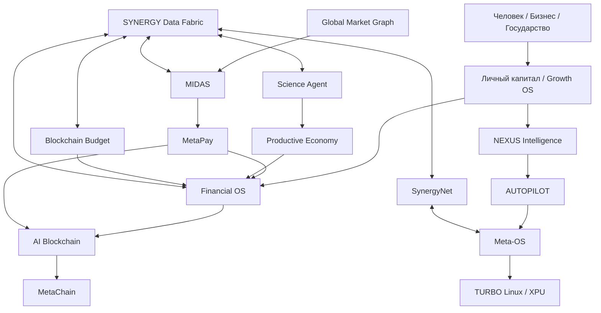

# СИНЕРГИЯ

## Большая цифровая система для личного капитала, бизнеса, инвестиций, науки, промышленности и государства

> **СИНЕРГИЯ — это попытка собрать в одну проверяемую систему то, что сегодня существует отдельно:** деньги человека, бизнес, инвестиции, платежи, бухгалтерию, искусственный интеллект, науку, промышленность, государственные расходы, блокчейн, сеть передачи данных и вычислительную инфраструктуру.
>
> Это не один бот, не один токен, не одна нейросеть и не один блокчейн. Это **федерация независимых технологических систем**, каждая из которых отвечает только за свою часть реальности.

**Статус:** R&D / pre-production / regulatory sandbox candidate  
**Дата среза:** 6 сентября 2026  
**Архитектурный корень:** [`Shtenco/synergy_system`](https://github.com/Shtenco/synergy_system)  
**Техническая федерация:** **45 репозиториев**  
**Master dossier:** `Shtenco/synergy_project`  
**Всего наблюдаемых репозиториев:** **46**  
**Основатель и системный архитектор:** Евгений Коштенко

---

# 1. Что такое СИНЕРГИЯ простыми словами

Представьте экономику как огромный организм.

У человека есть доходы, расходы, долги, накопления и инвестиции. У бизнеса есть продажи, сотрудники, закупки и прибыль. У инвестиционной системы есть рынок и риск. У государства есть бюджет и закупки. У науки есть гипотезы и эксперименты. У промышленности есть заводы, оборудование и реальные товары.

Сегодня эти миры соединены плохо. Информация находится в разных программах. Деньги идут по одним каналам, бухгалтерия — по другим, решения принимает кто-то третий, а доказательства того, что реально произошло, часто хранятся вообще отдельно.

**СИНЕРГИЯ строится как единая цифровая нервная система между этими мирами.**

```text
ЧЕЛОВЕК
  ↓
ЛИЧНЫЙ КАПИТАЛ
  ↓
БИЗНЕС И ПРОИЗВОДСТВО
  ↓
ИНВЕСТИЦИИ И КАПИТАЛ
  ↓
НАУКА И ТЕХНОЛОГИИ
  ↓
ПРОМЫШЛЕННОСТЬ И РЕАЛЬНАЯ ЭКОНОМИКА
  ↓
ВНЕШНЯЯ ВЫРУЧКА / ДОХОД
  ↓
ПЛАТЕЖ И РАСЧЁТ
  ↓
БУХГАЛТЕРСКАЯ ИСТИНА
  ↓
РЕИНВЕСТИРОВАНИЕ / РАСПРЕДЕЛЕНИЕ
  ↓
ЧЕЛОВЕК
```

Искусственный интеллект помогает анализировать и предлагать решения. Платёжная система исполняет платежи. Financial OS считает экономический результат. Блокчейн фиксирует доказательства. Сеть переносит данные. Архиваторы уменьшают объём хранения и передачи. Meta-OS запускает сервисы. TURBO/XPU — исследовательская база будущей вычислительной машины.

Главная идея очень проста:

> **каждая технология делает только то, что умеет доказуемо делать, и не притворяется другой системой.**

---

# 2. Почему проект настолько большой

СИНЕРГИЯ выросла не из одного приложения. За несколько лет появлялись отдельные направления: трейдинг, AI, платежи, токены, персональные финансы, блокчейн, государственный бюджет, научные расчёты, операционная система, XPU, сети и архиваторы.

Вместо того чтобы выбросить старые поколения и собрать красивый, но пустой монорепозиторий, проект сохраняет их как **технологическую эволюцию**.

Сегодня структура выглядит так:

```text
45 TECHNICAL REPOSITORIES
        │
        ├── Personal Capital
        ├── Business / Growth OS
        ├── Financial OS
        ├── MetaPay
        ├── MIDAS
        ├── Global Market Graph
        ├── NEXUS / OLGA / AUTOPILOT
        ├── Science Agent
        ├── Productive Economy
        ├── Budget / GovTech
        ├── AI Blockchain
        ├── MetaChain
        ├── SynergyNet
        ├── Data Fabric / Compressors
        ├── Meta-OS
        ├── TURBO Linux
        └── XPU / EML

+ 1 MASTER DOSSIER
        └── synergy_project
```

Полный реестр: [`REPOSITORIES.md`](REPOSITORIES.md)  
Полный аудит технологий всех 46 observed repo: [`TECHNOLOGY_AUDIT_46.md`](TECHNOLOGY_AUDIT_46.md)

---

# 3. Главный принцип: реальность важнее красивых цифр

В центре СИНЕРГИИ находится жёсткое экономическое правило:

> ## **No external settlement ⇒ no external profit.**
> ## **Нет внешнего расчёта — нет внешней прибыли.**

Это значит:

```text
напечатать токен                 != заработать деньги
сделать rebase                   != заработать деньги
поднять внутреннюю цену          != заработать деньги
переложить свои резервы          != заработать деньги
взять flash loan                 != заработать деньги
увеличить внутренний TVL         != заработать деньги
получить красивый backtest       != получить реальную прибыль
получить ответ AI                != доказать факт
записать число в blockchain      != создать экономическую ценность
```

Реальная стоимость появляется только там, где есть внешний источник:

- продажа реального товара или услуги;
- прибыль производственного проекта;
- внешнее инвестиционное вознаграждение;
- реализованный торговый P&L;
- комиссия за реальную услугу;
- погашение реального требования;
- другой экономически обеспеченный внешний cash flow.

Это правило специально встроено в архитектуру, чтобы проект **не мог сам себя обмануть внутренней переоценкой**.

---

# 4. Как устроена СИНЕРГИЯ



---

# 5. «Личный капитал» — система человека

Один из самых понятных входов в СИНЕРГИЮ — приложение **«Личный капитал»**.

Его базовая идея:

```text
Доходы − Расходы = Дельта
Дельта → Резерв + Погашение долгов + Инвестиции
Инвестиции → Активы
Активы − Пассивы = Чистый капитал
Капитал × Время × Сложный процент → Финансовая устойчивость
```

Но приложение должно быть не обычным учётом расходов.

Целевая система включает:

- бюджет;
- финансовые конверты;
- резерв на 3–6 месяцев;
- долги и стоимость обслуживания долга;
- инвестиционные цели;
- прогноз сложного процента;
- стресс-сценарии;
- финансовую свободу как измеримую цель;
- AI-помощника;
- связь с остальными экономическими сервисами СИНЕРГИИ.

Канонический продукт: [`Shtenco/synergy_app`](https://github.com/Shtenco/synergy_app)

---

# 6. Business / Growth OS — цифровая система бизнеса

СИНЕРГИЯ рассматривает бизнес как второй большой источник реальной экономической ценности.

Growth OS объединяет:

- CRM;
- продажи;
- AI SMM;
- AI CFO;
- работу с клиентами;
- автоматизацию процессов;
- франчайзинг;
- партнёрские программы;
- бизнес-аналитику;
- AI-отделы;
- человеческий контроль.

Важная граница:

> **recruitment ≠ revenue**

Вознаграждение должно возникать за реальную продажу, услугу или измеримый вклад, а не просто за привлечение нового участника.

Ключевой проект: [`Shtenco/synergychain`](https://github.com/Shtenco/synergychain)

---

# 7. Financial OS — экономическая правда всей системы

Если представить СИНЕРГИЮ организмом, **Financial OS — это бухгалтерская память и экономическая совесть системы**.

Она должна отвечать на вопросы:

- сколько у нас действительно денег;
- сколько обязательств;
- какой HardNAV;
- какая ликвидность;
- какой доход реально признан;
- что является прибылью, а что внутренним перемещением;
- сколько можно безопасно распределить;
- что произошло после отмены/возврата/ошибки;
- можно ли воспроизвести состояние прошлого периода.

Целевой pipeline:

```text
ВНЕШНЕЕ СОБЫТИЕ
      ↓
SETTLEMENT EVIDENCE
      ↓
ECONOMIC CLASSIFICATION
      ↓
REVENUE / P&L RECOGNITION
      ↓
DOUBLE ENTRY
      ↓
ACCOUNTING CLOSE
      ↓
HardNAV / LIQUIDITY / SOLVENCY
      ↓
AVAILABLE CAPACITY
      ↓
REINVESTMENT / DISTRIBUTION
```

Канонический владелец бухгалтерской истины: [`Shtenco/synergy_financial_os`](https://github.com/Shtenco/synergy_financial_os)

---

# 8. MetaPay — платёжная система

MetaPay не решает, заработала ли СИНЕРГИЯ деньги. Она отвечает на другой вопрос:

> **что было реально отправлено, исполнено, рассчитано и сверено?**

```text
Payment Intent
   ↓
Funding Reservation
   ↓
Route / Quote
   ↓
Execution
   ↓
Settlement
   ↓
Reconciliation
   ↓
Receipt
   ↓
Financial OS
```

Архитектура охватывает исследования fiat, crypto, CBDC, CEX, DEX, bridges, банковских и merchant-интеграций, но наличие адаптера в коде не означает автоматически наличие банковского договора, лицензии или production-доступа.

Канонический проект: [`Shtenco/synergy_pay_system`](https://github.com/Shtenco/synergy_pay_system)

---

# 9. MIDAS — цифровой инвестиционный комитет

MIDAS — одна из самых больших исследовательских линий проекта.

Это не один торговый робот. Целевая идея — **многоуровневая система инвестиционного принятия решений**:

```text
Market Data
   ↓
Causal Alignment
   ↓
Features
   ↓
Statistical / ML / Graph / Vision Experts
   ↓
Regime Models
   ↓
Portfolio Allocator
   ↓
Independent Risk Engine
   ↓
Execution
   ↓
Reconciliation
   ↓
Realized External P&L
   ↓
Financial OS
```

В исторических репозиториях накоплены:

- CatBoost / XGBoost / LSTM / RL исследования;
- компьютерное зрение рынка;
- 3D volume-time-price bars;
- carry/swap portfolios;
- cross-rate arbitrage;
- global liquidity features;
- multi-threaded trading;
- portfolio/risk engines;
- MetaTrader infrastructure;
- множество поколений MIDAS.

Новые версии должны проходить:

`TRAIN → TEST → OOS → WALK-FORWARD → SHADOW → LIVE → RECONCILED`.

Backtest никогда не становится реальным доходом автоматически.

Канонический target: [`Shtenco/midas_ai`](https://github.com/Shtenco/midas_ai)

---

# 10. Глобальный граф денег и ликвидности

Отдельное направление строит мировой рынок как граф.

Узел — это не просто «USD» или «банк».

```text
Node =
(institution,
 venue,
 account/channel,
 currency/asset,
 settlement_date)
```

Ребро содержит:

```text
rate
fees
capacity
spread
slippage
latency
settlement date
available liquidity
execution evidence
```

На таком графе можно искать:

- лучшие валютные маршруты;
- циклы mispricing;
- арбитражные кандидаты;
- дешёвые пути ребалансировки;
- capacity bottlenecks;
- разницу между trading alpha и payment routing.

Главный invariant:

> **AlphaGraph != RebalancingGraph**

Исследовательский target: [`Shtenco/algotrading_graph_system`](https://github.com/Shtenco/algotrading_graph_system)

---

# 11. NEXUS — интеллект, но не диктатор

NEXUS — исследовательская линия универсального reasoning engine.

Он может:

- рассуждать;
- строить гипотезы;
- анализировать графы;
- прогнозировать;
- объяснять;
- предлагать решения;
- работать с world models;
- оценивать неопределённость.

Но по архитектуре он **не получает автоматически власть над деньгами**.

```text
NEXUS
  ↓ proposal
AUTOPILOT
  ↓ policy / capability
DOMAIN AUTHORITY
  ↓
EXECUTION
```

NEXUS не является автоматически:

- бухгалтером;
- банком;
- подписантом;
- владельцем treasury;
- blockchain consensus;
- production deployer.

Канонический intelligence target: [`Shtenco/agi_nexus`](https://github.com/Shtenco/agi_nexus)  
Историческая исследовательская линия: [`Shtenco/agi_olga`](https://github.com/Shtenco/agi_olga)  
Контур действий: [`Shtenco/agi_autopilot`](https://github.com/Shtenco/agi_autopilot)

---

# 12. Science Agent — машина научной проверки

СИНЕРГИЯ должна уметь не только зарабатывать и считать деньги, но и **создавать новые технологии**.

Поэтому Science Agent строится не как «AI, который всегда знает ответ», а как система:

```text
ВОПРОС
  ↓
ПОИСК ИСТОЧНИКОВ
  ↓
CLAIMS / EVIDENCE GRAPH
  ↓
ПРОТИВОРЕЧИЯ
  ↓
ГИПОТЕЗА
  ↓
РАСЧЁТ / СИМУЛЯЦИЯ
  ↓
ПОПЫТКА ОПРОВЕРЖЕНИЯ
  ↓
ЭКСПЕРИМЕНТ
  ↓
ВОСПРОИЗВЕДЕНИЕ
  ↓
TRL
  ↓
IP / ПАТЕНТ
  ↓
ПРОИЗВОДСТВО
```

Научная гипотеза не становится истиной только потому, что AI или симуляция выдали красивое число.

Проект: [`Shtenco/nexus_science_agent`](https://github.com/Shtenco/nexus_science_agent)

Научные R&D-линии включают, среди прочего:

- [`binary_quantum_theory`](https://github.com/Shtenco/binary_quantum_theory);
- [`cold_nuclear`](https://github.com/Shtenco/cold_nuclear).

Они остаются исследовательскими программами и не выдаются за экспериментально подтверждённую физику.

---

# 13. Productive Economy — переход от цифровых чисел к реальному производству

Ключевая долгосрочная идея СИНЕРГИИ — **капитал должен уметь превращаться в реальные производительные активы**.

```text
Capital
   ↓
Project Proposal
   ↓
Economic Model
   ↓
Risk / Evidence
   ↓
Funding Decision
   ↓
Equipment / Infrastructure / Production
   ↓
Goods / Services
   ↓
External Revenue
   ↓
Financial OS
```

Исследуются:

- промышленность;
- инфраструктура;
- сельское хозяйство;
- региональное развитие;
- производственные цепочки;
- CAPEX;
- мультипликаторы;
- занятость;
- импортозамещение;
- технологическое развитие.

Целевой домен: [`Shtenco/synergy_eurasian`](https://github.com/Shtenco/synergy_eurasian)

---

# 14. Blockchain Budget — прозрачность государственного бюджета

Отдельная ветвь проекта переносит доказательную архитектуру на государственные расходы.

Идея:

```text
Закон
 ↓
Бюджетное ассигнование
 ↓
Лимит
 ↓
Обязательство
 ↓
Контракт
 ↓
Поставщик
 ↓
Платёж
 ↓
Кассовое исполнение
 ↓
Evidence / Merkle Proof
```

Цель — не «посадить бюджет в токен», а сделать движение публичных средств **трассируемым и проверяемым**.

Проект: [`Shtenco/blochain_budget`](https://github.com/Shtenco/blochain_budget)

---

# 15. SYNERGY Data Fabric — память всей системы

Один из важнейших новых слоёв Федерации — **Data Fabric**.

Раньше архиваторы `ai_compress` и `qr_compress` существовали почти отдельно. После полного аудита стало очевидно: это фундаментальная инфраструктура всей СИНЕРГИИ.

Data Fabric должен обслуживать:

- бухгалтерские snapshots;
- settlement evidence;
- MIDAS datasets и модели;
- NEXUS artifacts;
- научные datasets;
- государственные архивы и proofs;
- программный код;
- логи;
- модели;
- node snapshots;
- offline payloads;
- будущий persistent state XPU.

Главное правило:

```text
canonical_content_sha256 = hash исходного канонического объекта
archive_sha256           = hash конкретного сжатого представления
```

Это означает:

> один и тот же финансовый или научный факт может завтра быть пересжат другим codec, но его смысл и canonical hash не меняются.

### `ai_compress`

В накопленной линии есть:

- EGD-256;
- SABF-X;
- HACE-X;
- TSC-X;
- AMCE-100X;
- UMC-256;
- Graph-AI Compression V5.2;
- GRAAL-IGC;
- Gabriel Horn `SGH1`;
- Arithmetic / rANS / Huffman / Graph Delta;
- MDL routing;
- deduplication;
- random access;
- reproducимые benchmark и SHA-256 round-trip tests.

Проект: [`Shtenco/ai_compress`](https://github.com/Shtenco/ai_compress)

### `qr_compress`

QTC1/QTC2 исследуют компактную offline-передачу:

- shared temporal dictionary;
- exact / patch / standalone modes;
- temporal addressing;
- residual compression;
- QF1 multi-frame QR transport;
- integrity checks;
- offline references для evidence, identity, payment intents и node enrollment.

Важно:

> **QR transport != authorization**

Сам факт, что QR или QTC payload прочитан, не даёт права списать деньги или изменить ledger.

Проект: [`Shtenco/qr_compress`](https://github.com/Shtenco/qr_compress)

---

# 16. SynergyNet — сеть передачи доказательств и данных

SynergyNet исследует P2P-сеть, где узлы могут быть:

```text
CLIENT
RELAY
CACHE
GATEWAY
BLOCKCHAIN PEER
NEXUS COMPUTE
METAPAY EDGE
FULL SYNERGY NODE
```

Целевой pipeline:

```text
Object
 ↓
Chunking
 ↓
Content Hash
 ↓
Dedup
 ↓
Compression
 ↓
Authenticated Transport
 ↓
Multipath / Relay / Store-and-Forward
 ↓
Cache
 ↓
Reconstruction
 ↓
Integrity Verification
```

«Быстрее Интернета» пока является исследовательской гипотезой, а не подтверждённым фактом. Производительность должна сравниваться с реальными baseline TCP/QUIC/CDN/P2P.

Проект: [`Shtenco/synergynet`](https://github.com/Shtenco/synergynet)

---

# 17. Blockchain и MetaChain — доказательство, а не источник истины

Blockchain в СИНЕРГИИ не должен решать, сколько денег заработано.

Это уже решил соответствующий authoritative domain.

Blockchain получает готовый факт и фиксирует commitment:

```text
Domain Fact
   ↓
Canonical Bytes
   ↓
Hash / Typed Commitment
   ↓
Signature
   ↓
Blockchain
   ↓
Checkpoint / Proof
```

Цели направления:

- typed commitments;
- post-quantum signatures;
- checkpoints;
- key rotation/revocation;
- light clients;
- bridge proofs;
- cross-chain verification.

Проекты:

- [`Shtenco/synergy_ai_blockchain`](https://github.com/Shtenco/synergy_ai_blockchain)
- [`Shtenco/synergy_metachain`](https://github.com/Shtenco/synergy_metachain)

---

# 18. Meta-OS, TURBO Linux и XPU — вычислительное основание

СИНЕРГИЯ исследует не только приложения, но и собственную вычислительную инфраструктуру.

### Meta-OS

Meta-OS — дирижёр одного узла:

- запускает сервисы;
- проверяет manifest;
- выдаёт capabilities;
- следит за health;
- обновляет;
- откатывает;
- собирает audit evidence.

Но запуск сервиса не означает финансовое разрешение.

Проект: [`Shtenco/synergy_meta_os`](https://github.com/Shtenco/synergy_meta_os)

### TURBO Linux

R&D собственного host/kernel/runtime направления:

- capability-oriented primitives;
- bounded IPC;
- scheduler;
- virtualization;
- host isolation;
- secure runtime research.

Проект: [`Shtenco/turbo_linux`](https://github.com/Shtenco/turbo_linux)

### XPU / EML

Самая дальняя вычислительная линия — persistent programmable dataflow XPU.

Идея разделяет:

```text
Value State
Graph State
Persistent State
```

и исследует выполнение заранее скомпилированных вычислительных графов на тысячах lanes без центрального runtime walker.

Проект: [`Shtenco/motherboard_xpu_xml`](https://github.com/Shtenco/motherboard_xpu_xml)

Это пока R&D-архитектура, а не изготовленный процессор.

---

# 19. Печатный станок СИНЕРГИИ

## Одна из самых необычных исследовательских идей проекта

В СИНЕРГИИ существует целая линия исследований, которую мы условно называем **«печатным станком»**.

Название специально провокационное, но его зрелая идея **не состоит в создании денег из воздуха**.

Печатный станок исследует другое:

> **можно ли использовать внутреннюю эмиссию, AMM, временную ликвидность, flash liquidity, bridges, market making, циклическое перераспределение и динамическое управление резервами как механизм ускорения уже существующего внешнего двигателя стоимости?**

То есть правильная модель выглядит не так:

```text
MINT
 ↓
PROFIT
```

а так:

```text
ВНЕШНИЙ ДВИГАТЕЛЬ СТОИМОСТИ
(real business / trading / productive cash flow / service fee)
             ↓
        REAL VALUE
             ↓
      Financial OS
             ↓
      reserve / capital
             ↓
┌────────────────────────────────┐
│  SYNERGY PRINT-MACHINE R&D     │
│                                │
│ mint / burn                    │
│ internal AMM                   │
│ market making                  │
│ temporary liquidity            │
│ flash liquidity                │
│ bridges                        │
│ inventory rebalancing          │
│ reserve restoration            │
│ capital routing                │
└────────────────────────────────┘
             ↓
  ускорение оборота капитала
             ↓
  следующий внешний цикл
```

### Что в нём действительно интересно

Внутренняя денежная/токенная система может быть полезна как:

- механизм маршрутизации капитала;
- временный liquidity layer;
- средство балансировки inventory;
- collateral/accounting representation;
- внутренний расчётный контур;
- автоматизированный market-making mechanism;
- способ управлять скоростью оборота резервов;
- способ направлять капитал из одного productive contour в другой.

Но **это не создаёт внешний доллар само по себе**.

Именно поэтому в наших последних моделях введён жёсткий firewall:

```text
internal mint             != external profit
internal mark             != external profit
own reserve movement      != external profit
flash principal           != external profit
synthetic TVL             != HardNAV
```

### Зачем тогда нужен «печатный станок»?

Потому что если внешний двигатель действительно умеет создавать стоимость, внутренний денежный механизм теоретически может:

1. быстрее направлять капитал туда, где он работает;
2. уменьшать простой ликвидности;
3. автоматически восстанавливать целевые резервы;
4. распределять риски между контурами;
5. использовать temporary liquidity вместо постоянного замораживания всего капитала;
6. связывать trading, productive economy и treasury в единый управляемый цикл.

Тогда «станок» становится не источником стоимости, а **мультипликатором эффективности капитала**.

### Какие репозитории связаны с этой линией

- [`Shtenco/ai_financial_system`](https://github.com/Shtenco/ai_financial_system) — AI Central Bank / AMM / QE / bridges / MEV / simulations;
- [`Shtenco/usds`](https://github.com/Shtenco/usds) — mint/sell/reserve-restoration experiments;
- [`Shtenco/print_money_synergychain`](https://github.com/Shtenco/print_money_synergychain) — отдельный falsification-контур внешней прибыли и HardNAV;
- [`Shtenco/cashero`](https://github.com/Shtenco/cashero) — историческая cyclic-liquidity/tokenomics линия;
- `synergy_financial_os` — финальный арбитр того, появилась ли реальная внешняя стоимость;
- `synergy_pay_system` — реальный settlement;
- `midas_ai` / productive economy — потенциальные внешние engines, но только после доказательства их фактического результата.

### Самая важная формула печатного станка

```text
PRINT MACHINE VALUE
    = External Productive/Trading Value
    × Capital Efficiency
    − Liquidity Costs
    − Funding Costs
    − Market Impact
    − Gas / Fees
    − Losses / Risk
```

Если первый член равен нулю, **никакая внутренняя эмиссия не спасает систему**.

Это одна из принципиальных интеллектуальных границ проекта: СИНЕРГИЯ не пытается математически замаскировать эмиссию под доход. Наоборот, отдельный `print_money_synergychain` существует именно для того, чтобы **ломать такие модели и оставлять только то, что выдерживает проверку внешней стоимостью**.

---

# 20. Secure Event Fabric — как независимые системы разговаривают друг с другом

Большая система ломается, если один сервис может тихо изменить факт другого.

Поэтому Federation V3 развивает Secure Event Fabric:

```text
Validated Domain Contract
       ↓
Signed Immutable Envelope
       ↓
Transactional Outbox
       ↓
SynergyNet
       ↓
Persistent Inbox / Replay Ledger
       ↓
Domain Consumer
       ↓
ACK / RETRY / DLQ / QUARANTINE
```

Правила:

- доставка может быть `at-least-once`, но обработка должна быть idempotent;
- конфликтующий replay запрещён;
- retry не меняет исходный факт;
- reversal создаёт новый append-only факт;
- transport не получает финансовой authority;
- Meta-OS не получает бухгалтерской authority;
- AI не получает signing authority только потому, что он AI.

---

# 21. One authority per fact

Это один из главных архитектурных законов всей Федерации.

| Что считается истиной | Кто отвечает |
|---|---|
| Архитектура, constitution, authority map | `synergy_system` |
| Runtime orchestration | `synergy_meta_os` |
| Host/kernel | `turbo_linux` |
| Compute R&D | `motherboard_xpu_xml` |
| P2P transport | `synergynet` |
| Compression/archive profiles | `ai_compress` |
| Offline compact transport | `qr_compress` — **без financial authority** |
| Reasoning | `agi_nexus` |
| Policy/action orchestration | `agi_autopilot` |
| Scientific workflow | `nexus_science_agent` |
| Trading intelligence | `midas_ai` |
| Payment/settlement | `synergy_pay_system` |
| Accounting / HardNAV | `synergy_financial_os` |
| PQ blockchain commitments | `synergy_ai_blockchain` |
| Cross-chain verification | `synergy_metachain` |
| Productive economy modelling | `synergy_eurasian` |
| Public budget traceability | `blochain_budget` |
| Personal-capital product | `synergy_app` |

---

# 22. Что уже есть, а что ещё исследуется

СИНЕРГИЯ — большой проект, но мы специально не называем всю систему production-ready раньше времени.

### Уже существует как код / архитектура / воспроизводимые R&D-компоненты

- 45-repository Federation map;
- authority/evidence constitution;
- Financial OS lineage;
- MetaPay integration core;
- MIDAS research corpus;
- NEXUS/OLGA research generations;
- business/Growth OS;
- Personal Capital application lineage;
- budget traceability engine;
- science-agent architecture;
- compression engines и benchmark infrastructure;
- QTC/QTD temporal compression;
- SynergyNet architecture;
- Meta-OS architecture;
- PQ blockchain/metachain R&D;
- TURBO kernel/runtime research;
- XPU quantitative architecture;
- monetary/print-machine falsification experiments.

### Ещё требуется доказать

- literal multi-repo production-like E2E;
- независимый security audit;
- HSM/KMS/MPC production custody;
- лицензированные live payment corridors;
- устойчивый live-settled MIDAS edge;
- реальный production SynergyNet benchmark;
- широкие реальные budget pilots;
- FPGA/silicon XPU evidence;
- независимое воспроизведение научных результатов;
- коммерческую экономику отдельных контуров.

Именно поэтому правильная текущая формулировка:

> **СИНЕРГИЯ — крупная federated R&D platform и кандидат на regulatory sandbox, а не завершённая национальная production-инфраструктура.**

---

# 23. Регуляторная песочница

Такой проект нельзя безопасно запускать сразу «на всю экономику».

Правильный путь:

```text
RESEARCH
   ↓
PROTOTYPE
   ↓
LOCAL TEST
   ↓
SANDBOX
   ↓
SHADOW
   ↓
CAPPED CANARY
   ↓
LIMITED LIVE
   ↓
PRODUCTION
```

В песочнице можно отдельно проверять:

- личные финансы;
- payment lifecycle;
- accounting;
- algorithmic trading;
- AI governance;
- public budget evidence;
- data transport;
- security;
- scientific workflow;
- capital-allocation mechanics;
- «печатный станок» только как ограниченный falsifiable economic experiment.

---

# 24. Экономическая идея всей СИНЕРГИИ

В конечном счёте система должна замыкать один очень большой цикл:

```text
ЛЮДИ
 ↓
НАКОПЛЕНИЯ
 ↓
КАПИТАЛ
 ↓
БИЗНЕС / ИНВЕСТИЦИИ / НАУКА
 ↓
ПРОИЗВОДИТЕЛЬНОСТЬ
 ↓
ТОВАРЫ И УСЛУГИ
 ↓
ВНЕШНЯЯ ВЫРУЧКА
 ↓
ПЛАТЕЖ
 ↓
БУХГАЛТЕРСКАЯ ИСТИНА
 ↓
РЕИНВЕСТИРОВАНИЕ
 ↓
БОЛЬШЕ ПРОИЗВОДИТЕЛЬНОГО КАПИТАЛА
```

AI ускоряет поиск решений. MIDAS исследует доходность капитала. Science Agent ищет новые технологии. Data Fabric хранит знания. SynergyNet переносит данные. Blockchain доказывает неизменность. MetaPay рассчитывается. Financial OS говорит, что произошло экономически. Productive Economy превращает капитал в реальные активы.

Именно в этом смысл слова **СИНЕРГИЯ**:

> **ценность должна возникать не из одного чудо-модуля, а из правильно соединённых систем, каждая из которых усиливает остальные и при этом остаётся проверяемой.**

---

# 25. Оценка технологического IP / know-how

После полного пересмотра 45 технических репозиториев и отдельного аудита Data Fabric внутренняя management-оценка составляет:

| Показатель | Indicative range |
|---|---:|
| Replacement / reproduction portfolio | **$12.4–34.5M** |
| Current risk-adjusted technology/IP/know-how | **$9.3–26.9M** |
| Post-sandbox option scenario | **$34.2–97.3M** |

Округлённо для внешнего представления:

> **Текущая внутренняя оценка технологического IP/know-how СИНЕРГИИ: примерно $9–27 млн.**

Это:

- не независимый appraisal;
- не audited fair value;
- не цена продажи;
- не обещание будущей капитализации.

Подробная методология: [`IP_VALUATION.md`](IP_VALUATION.md)

---

# 26. Откуда появилась эта идея

СИНЕРГИЯ не возникла в один день.

Её концептуальные корни уходят в более раннюю модель **«Новая Россия / Единая интеллектуальная система»**, где уже присутствовали:

- личный капитал;
- сеть людей и бизнеса;
- фонд развития;
- инвестиции;
- наука;
- промышленность;
- AI-управление;
- цифровая валюта;
- региональное развитие;
- системная математическая модель.

Современная СИНЕРГИЯ отличается тем, что старается превратить эти большие идеи в **отдельные falsifiable engineering domains с чёткими границами authority**.

То, что раньше существовало как один большой концепт, сегодня разложено на десятки репозиториев, тестов, контрактов, моделей и доказательных контуров.

---

# 27. Куда смотреть дальше

### Полная карта репозиториев

[`REPOSITORIES.md`](REPOSITORIES.md)

### Глубокий аудит всех 46 observed repositories

[`TECHNOLOGY_AUDIT_46.md`](TECHNOLOGY_AUDIT_46.md)

### Оценка IP / know-how

[`IP_VALUATION.md`](IP_VALUATION.md)

### Архитектурный корень Федерации

[`Shtenco/synergy_system`](https://github.com/Shtenco/synergy_system)

---

# 28. Коротко: что мы пытаемся построить

Не ещё один банк.  
Не ещё одну криптовалюту.  
Не ещё одного торгового робота.  
Не ещё один ChatGPT-клон.  
Не ещё один блокчейн.  
Не ещё одну бухгалтерскую программу.

**СИНЕРГИЯ — это попытка соединить их функции в одну большую, проверяемую и экономически честную цифровую систему.**

```text
Человек
+ Личный капитал
+ Бизнес
+ Реальная экономика
+ Инвестиции
+ Платежи
+ Бухгалтерия
+ AI
+ Наука
+ Промышленность
+ Государственный бюджет
+ Data Fabric
+ P2P-сеть
+ Blockchain
+ MetaChain
+ Meta-OS
+ TURBO
+ XPU
= СИНЕРГИЯ
```

И главный вопрос проекта звучит не:

> «Можно ли придумать красивую модель?»

а:

> **«Можно ли построить систему, где каждый экономический и технологический результат можно проверить, воспроизвести и связать с реальным источником ценности?»**

Именно это СИНЕРГИЯ пытается доказать — шаг за шагом.
