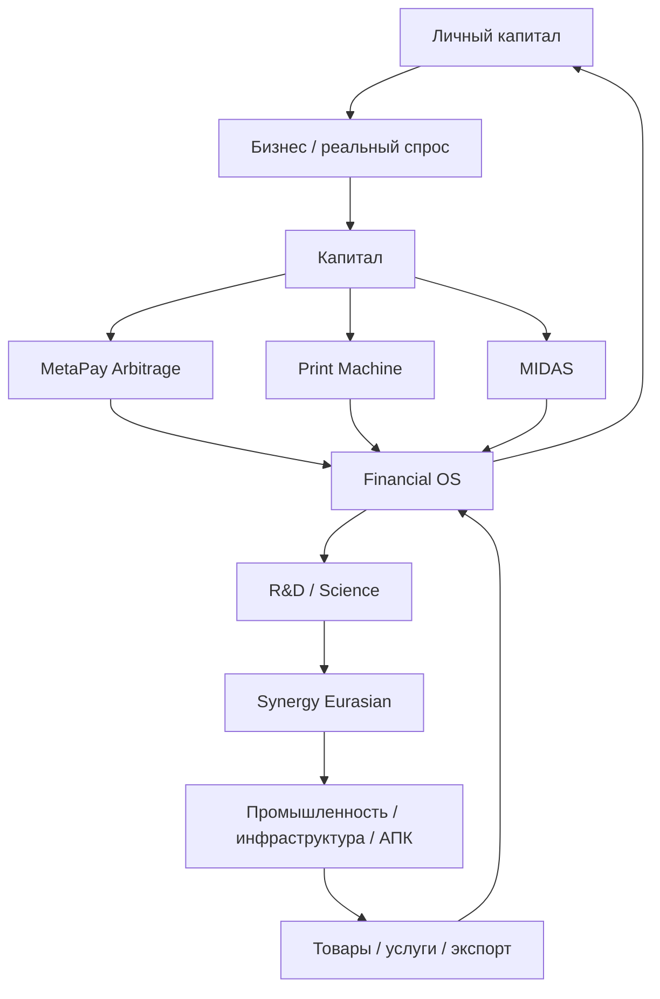
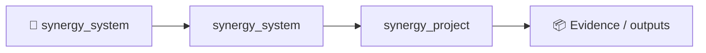

# СИНЕРГИЯ

## Федеративная экономическая операционная система: личный капитал → внешняя прибыль → наука → промышленность → новый внешний доход

> **СИНЕРГИЯ — это не один токен, не один торговый робот и не одна нейросеть.**  
> Это большая федерация независимых технологических систем, которые соединяют человека, бизнес, инвестиции, платежи, бухгалтерию, науку, промышленность, государственные расходы, AI, блокчейн, сеть передачи данных и вычислительную инфраструктуру в один проверяемый экономический контур.

**Статус:** R&D / pre-production / regulatory sandbox candidate  
**Дата среза:** 6 сентября 2026  
**Архитектурный корень:** [`Shtenco/synergy_system`](https://github.com/Shtenco/synergy_system)  
**Техническая федерация:** **45 репозиториев**  
**Master dossier:** `Shtenco/synergy_project`  
**Всего наблюдаемых репозиториев:** **46**  
**Основатель и системный архитектор:** Евгений Коштенко

---

# 1. Идея в одном абзаце

СИНЕРГИЯ строит систему, в которой деньги не должны просто лежать, внутренне переоцениваться или бесконечно перемещаться между счетами. Капитал должен проходить полный цикл:

```text
ЧЕЛОВЕК / БИЗНЕС / ИНВЕСТОР
            ↓
        СВОБОДНАЯ ДЕЛЬТА
            ↓
     КАПИТАЛ / РЕЗЕРВ
            ↓
┌───────────────────────────────────────────────┐
│   ТРИ ФИНАНСОВЫХ ДВИГАТЕЛЯ ВНЕШНЕЙ СТОИМОСТИ│
│                                               │
│  1. MetaPay Arbitrage Engine                  │
│  2. SYNERGY Print Machine                     │
│  3. MIDAS Institutional                       │
└───────────────────────────────────────────────┘
            ↓
   ВНЕШНИЙ SETTLEMENT / CASH FLOW
            ↓
       FINANCIAL OS
            ↓
  РЕЗЕРВЫ / РЕИНВЕСТИРОВАНИЕ
            ↓
   НАУКА → ТЕХНОЛОГИИ → ПРОИЗВОДСТВО
            ↓
  ТОВАРЫ / УСЛУГИ / ЭКСПОРТ / ВЫРУЧКА
            ↓
         НОВЫЙ КАПИТАЛ
            ↓
           ЦИКЛ
```

Главный смысл проекта — **соединить финансовый капитал с созданием реальных технологий и производительных активов**, а затем вернуть результат обратно человеку, бизнесу и экономике.

---

# 2. Три главных денежных двигателя СИНЕРГИИ

Это центральная экономическая конструкция проекта.

## Двигатель №1 — MetaPay Arbitrage Engine

MetaPay — не просто платёжный шлюз. В текущей архитектуре это ещё и **граф маршрутов, котировок, ликвидности и расчётов** между различными внешними площадками.

Он может моделировать и исследовать:

- банки и платёжные коридоры;
- fiat ↔ crypto ↔ CBDC;
- CEX;
- DEX/AMM;
- DEX aggregators;
- OTC;
- bridges;
- Bitcoin / Lightning;
- EVM-сети;
- Solana;
- TRON;
- TON;
- Cosmos/IBC;
- Polkadot;
- Stellar;
- внешние exchange-rate и merchant adapters.

### Простая идея

Если один и тот же экономический актив в разных разрешённых каналах имеет разные исполнимые цены, система ищет путь:

```text
USD
 ↓
Venue A
 ↓
Asset X
 ↓
Venue B
 ↓
EUR
 ↓
Bank / Settlement Rail
 ↓
USD
```

Но считается не красивый теоретический spread, а:

```text
Executable Price
- trading fee
- withdrawal fee
- bridge fee
- gas
- slippage
- banking cost
- tax/compliance cost
- settlement risk
- inventory cost
- capital lock-up
= NET EXTERNAL RESULT
```

MetaPay уже содержит multi-provider quote graph, CEX/DEX/bridge catalog, circular arbitrage discovery и live-readiness gates.

Ключевой принцип:

> **Найденный spread — ещё не прибыль. Прибыль появляется только после реального исполнения, settlement и reconciliation.**

### Две разные карты

СИНЕРГИЯ разделяет:

```text
ALPHA GRAPH
где существует экономическая возможность

и

REBALANCING GRAPH
как после исполнения вернуть капитал и ликвидность в нужные узлы
```

Это очень важно. Международный перевод может занимать часы или дни, а opportunity — секунды. Поэтому зрелая модель строится на **prefunded accounts**, а медленные банковские/межсетевые rails используются прежде всего для ребалансировки.

Целевой проект: [`Shtenco/synergy_pay_system`](https://github.com/Shtenco/synergy_pay_system)  
Исследовательский граф: [`Shtenco/algotrading_graph_system`](https://github.com/Shtenco/algotrading_graph_system)

---

## Двигатель №2 — Печатный станок СИНЕРГИИ

Это одна из самых необычных технологий проекта.

Название «печатный станок» не означает идею бесплатных денег.

Его зрелая задача — исследовать, можно ли **ускорить оборот уже существующей внешней стоимости** с помощью внутренней ликвидности и программируемой денежной топологии.

Исследуются:

- mint / burn;
- AMM;
- internal liquidity pools;
- triangular и multi-loop liquidity systems;
- временное добавление ликвидности;
- flash liquidity;
- bridges;
- reserve mechanics;
- market making;
- buyback;
- inventory rebalancing;
- QE/QT-like mechanisms;
- internal settlement assets;
- tokenized routing;
- восстановление резервов;
- внешние fee/arbitrage opportunities.

### Не так

```text
MINT
 ↓
БОГАТСТВО
```

### А так

```text
REAL EXTERNAL OPPORTUNITY
        ↓
External liquidity / real demand
        ↓
SYNERGY liquidity topology
        ↓
AMM / routing / temporary liquidity / bridges
        ↓
External execution
        ↓
External settlement
        ↓
Repayment of temporary capital
        ↓
Net external surplus
        ↓
Financial OS
```

### Жёсткий экономический firewall

```text
mint                  != profit
rebase                != profit
internal mark-up      != HardNAV
own LP revaluation    != external profit
moving own reserves   != profit
flash principal       != owned capital
```

Эксперимент должен показать минимум:

```text
DeltaHardNAV
DeltaExternalCash
DeltaLiabilities
ExternalPnL
InternalMarkChange
FlashDebt
Solvency
Liquidity
ExecutionCosts
```

Если после закрытия всех обязательств внешний капитал не вырос — «станок» ничего не напечатал в экономическом смысле.

Но если программируемая ликвидность помогает поймать **реальный внешний spread, fee, market-making income или другой внешний cash flow**, тогда она становится финансовым усилителем.

Основной R&D: [`Shtenco/print_money_synergychain`](https://github.com/Shtenco/print_money_synergychain)  
Связанные лаборатории: [`ai_financial_system`](https://github.com/Shtenco/ai_financial_system), [`usds`](https://github.com/Shtenco/usds), [`cashero`](https://github.com/Shtenco/cashero)

---

## Двигатель №3 — MIDAS Institutional

MIDAS — институциональный рыночный интеллект СИНЕРГИИ.

Он не ищет один «магический индикатор». Архитектура развивается как цифровой инвестиционный комитет:

```text
Market / Alternative Data
        ↓
Data Integrity
        ↓
Feature OS
        ↓
Graph / Macro / Microstructure / 3D / Vision
        ↓
Base Models
        ↓
Regime / Meta Models
        ↓
Portfolio Construction
        ↓
Position / Pyramiding
        ↓
Independent Risk Engine
        ↓
Execution Intent
        ↓
Broker / Exchange / Venue
        ↓
Settlement + Reconciliation
        ↓
REALIZED EXTERNAL P&L
        ↓
Financial OS
```

MIDAS объединяет accumulated R&D из множества поколений:

- CatBoost;
- temporal/binary feature representations;
- graph features;
- 3D market structure;
- computer vision;
- regime models;
- stop/target probabilities;
- volatility prediction;
- first-passage models;
- meta-models;
- RL research;
- portfolio covariance;
- risk allocation;
- carry/swap;
- market-neutral logic;
- cross-FX graphs;
- global liquidity features.

### Главное отличие от обычного торгового робота

MIDAS имеет право сказать:

```text
NO_TRADE
```

Risk engine должен иметь абсолютное veto на:

- excessive drawdown;
- leverage;
- concentration;
- stale data;
- spread/slippage;
- liquidity shortage;
- correlation shock;
- broken execution;
- low model confidence.

И опять действует главное правило:

> **Backtest equity не является деньгами. Внешняя стоимость возникает только после реального settlement и reconciliation.**

Canonical target: [`Shtenco/midas_ai`](https://github.com/Shtenco/midas_ai)

---

# 3. Финансовый трезубец

Три двигателя решают три разные задачи.

| Двигатель | Что ищет | Где создаётся потенциальная внешняя ценность |
|---|---|---|
| **MetaPay Arbitrage** | различия цен и маршрутов | банки, CEX, DEX, bridges, FX/CBDC/rails |
| **Print Machine** | эффективность ликвидности и капитала | external fees, market making, arb, programmable liquidity |
| **MIDAS** | прогнозируемый рыночный edge | рынки, портфели, risk-adjusted trading |

В упрощённой форме:

```text
ExternalFinancialValue
    = RealizedMetaPayArbitrage
    + RealizedPrintMachineExternalPnL
    + RealizedMIDASPnL
    - ExecutionCosts
    - FinancingCosts
    - RealizedLosses
```

Но итоговую экономическую классификацию выполняет только **Financial OS**.

```text
Three Engines
     ↓
Settlement Evidence
     ↓
Reconciliation
     ↓
Financial OS
     ↓
HardNAV / Liabilities / Liquidity / Solvency
```

---

# 4. Четвёртый большой контур — реальная экономика Евразии

Три финансовых двигателя нужны не только ради накопления цифровых балансов.

Самая большая долгосрочная идея СИНЕРГИИ — направлять капитал в **реальные производительные проекты**.

```text
ФИНАНСОВЫЙ КАПИТАЛ
        ↓
ПОИСК РЕАЛЬНОГО СПРОСА
        ↓
ПРОЕКТ
        ↓
ТЕХНОЛОГИЯ
        ↓
ОБОРУДОВАНИЕ / ЗАВОД / ИНФРАСТРУКТУРА
        ↓
ПРОДУКТ / УСЛУГА
        ↓
ВНЕШНЯЯ ВЫРУЧКА
        ↓
FINANCIAL OS
        ↓
РЕИНВЕСТИРОВАНИЕ
```

Целевой economic-domain: [`Shtenco/synergy_eurasian`](https://github.com/Shtenco/synergy_eurasian)

## 4.1 От торговли к производству

Одна из центральных идей ещё раннего проекта:

> **не просто зарабатывать на продаже чужого товара, а использовать данные о реальном спросе, чтобы понять, что выгодно производить самим.**

Современная цепочка:

```text
Persistent Real Demand
        ↓
Import / Supplier Analysis
        ↓
Localization Opportunity
        ↓
Project Proposal
        ↓
CAPEX / OPEX / Technology / Risk
        ↓
Underwriting
        ↓
Production
        ↓
External Sales
```

Это превращает торговую сеть из конечного бизнеса в **сенсор рынка для индустриализации**.

## 4.2 Промышленный портфель

Исследуемые направления:

- микроэлектроника;
- станкостроение;
- робототехника;
- additive manufacturing;
- software и compute infrastructure;
- фармацевтика и биотехнологии — только как evidence-gated projects;
- новые материалы;
- технологическая коммерциализация;
- экспорт.

## 4.3 Наука → промышленность

```text
Research
 ↓
Evidence
 ↓
Reproduction
 ↓
TRL
 ↓
Technology Candidate
 ↓
Economic Project
 ↓
Underwriting
 ↓
CAPEX
 ↓
Production
 ↓
External Sales
```

Научная идея не получает финансирование только потому, что она красивая.

## 4.4 Жильё и инфраструктура

Eurasian-модель включает:

- реновацию жилья;
- транспорт;
- коммунальную инфраструктуру;
- энергетику;
- цифровую инфраструктуру;
- муниципальные проекты;
- региональные портфели;
- lifecycle OPEX;
- ремонт и обслуживание после строительства.

То есть оценивается не только «сколько стоит построить», но и **сколько объект будет стоить экономике весь жизненный цикл**.

## 4.5 Сельское хозяйство

Контур включает:

- землю и почвы;
- урожайность;
- оборудование;
- семена/inputs;
- переработку;
- хранение;
- логистику;
- экспорт;
- фактическую урожайность против модельной.

## 4.6 Региональное развитие

Проект должен измерять не только прибыль владельца, но и:

- рабочие места;
- зарплаты;
- производительность;
- supplier network;
- local content;
- импортозависимость;
- локализацию;
- инфраструктурную нагрузку;
- экспортный потенциал;
- миграционные эффекты;
- налоговую базу.

## 4.7 Что содержит каждый реальный проект

```text
project_id
region
sector
CAPEX
OPEX
financing_structure
technology_readiness_level
import_dependence
localization
input_output_dependencies
capacity
utilization
jobs
productivity
target_markets
expected_cash_flows
stress_case
risks
physical_milestones
settlement_evidence
accounting_evidence
```

## 4.8 Системная динамика

Вместо одной красивой цифры ROI система рассматривает связанный state vector:

```text
X_t = [
  productive_capacity,
  utilization,
  employment,
  wages,
  demand,
  imports,
  exports,
  infrastructure,
  capital,
  liquidity,
  R&D,
  productivity
]
```

И проверяет:

- optimistic;
- base;
- pessimistic;
- crisis;
- saturation;
- capacity constraints;
- external shocks.

Фазы проекта:

```text
CONCEPT
  ↓
EVIDENCE_READY
  ↓
UNDERWRITTEN
  ↓
FUNDED
  ↓
BUILDING
  ↓
OPERATING
  ↓
EXTERNAL_REVENUE
  ↓
VERIFIED_OUTCOME
```

---

# 5. Историческая логика проекта: от «Консорциума» к Federation V3

СИНЕРГИЯ не появилась в 2026 году из пустоты.

Историческая линия:

```text
2018
Концепция «Консорциум»
  ↓
личные финансы
коллективная кооперация
фонд развития
наука
промышленность
цифровая валюта
AI-координация
  ↓
2025
«Единая интегрированная система»
  ↓
2026
45-repository Federation V3
```

Ранняя концепция была построена вокруг шести взаимосвязанных уровней:

```text
1. ЛИЧНЫЕ ФИНАНСЫ
2. СЕТЬ / БИЗНЕС
3. КАПИТАЛ / ФОНД
4. НАУКА
5. ПРОМЫШЛЕННОСТЬ
6. AI-КООРДИНАЦИЯ
```

Современная СИНЕРГИЯ сохранила эту логику, но разделила её на независимые системы с отдельными полномочиями и доказательствами.

---

# 6. Личный капитал — микроэкономический фундамент

Базовая формула проекта:

```text
Доходы - Расходы = Дельта
Дельта → Резерв / Инвестиции
Инвестиции → Активы
Активы - Обязательства = Чистый капитал
Капитал × Время × Сложный процент → Финансовая устойчивость
```

Важно: конкретные проценты распределения не являются обязательной догмой.

Историческая модель 5 счетов модернизируется в configurable buckets:

- текущие расходы;
- резерв;
- инвестиции;
- образование;
- крупные цели;
- качество жизни.

Цель системы — сначала создать положительную дельту и устойчивость, а уже потом увеличивать риск.

Проекты:

- [`Shtenco/synergy_app`](https://github.com/Shtenco/synergy_app)
- [`Shtenco/synergy_matrix_sota`](https://github.com/Shtenco/synergy_matrix_sota)

---

# 7. Business / Growth OS

Сетевой эффект из ранней концепции сохраняется, но экономически очищается.

```text
recruitment != revenue
```

Современная сеть может вознаграждать:

- реальные продажи;
- оказанные услуги;
- measurable contribution;
- franchise operations;
- поставки;
- production cooperation;
- подтверждённый business value.

Не должна вознаграждать само привлечение новых денег как источник «прибыли».

Business/Growth OS может объединять:

- CRM;
- SMM;
- sales;
- referrals;
- franchise templates;
- AI-CFO;
- marketing;
- procurement demand signals;
- переход торговых компаний к собственному производству.

Проект: [`Shtenco/synergychain`](https://github.com/Shtenco/synergychain)

---

# 8. Фонд развития в современной архитектуре

Исторически в центре СИНЕРГИИ стоял общий Фонд развития.

Современная реализация не должна быть одним непрозрачным кошельком.

Она раскладывается на:

```text
Capital Commitment
Liquidity Bucket
Project Allocation
Trading Allocation
Reserve
Liabilities
Settlement Evidence
Accounting Close
Distribution Capacity
```

Фонд не обещает фиксированную доходность.

Исторические схемы вроде «30% распределить / 70% реинвестировать» могут использоваться только как **scenario policy**, а не как гарантированный контракт.

Распределять можно только то, что реально существует после:

```text
external settlement
- liabilities
- reserve requirements
- committed capital
- liquidity buffer
- stress buffer
```

Accounting authority: [`Shtenco/synergy_financial_os`](https://github.com/Shtenco/synergy_financial_os)

---

# 9. Financial OS — бухгалтерская истина всей СИНЕРГИИ

Это один из самых важных компонентов.

Financial OS отвечает за:

- double-entry ledger;
- HardNAV;
- Liquid NAV;
- liabilities;
- solvency;
- liquidity;
- revenue recognition;
- settlement-backed P&L;
- accounting close;
- replay/restatement;
- reversals;
- distributable capacity;
- audit evidence.

Главный закон всей экономики проекта:

> **No External Settlement ⇒ No External Profit.**

Не являются внешней прибылью сами по себе:

- mint;
- rebase;
- внутренний token price;
- backtest;
- unrealized model mark;
- движение собственных резервов;
- flash principal;
- рост собственной LP valuation;
- вклад нового участника;
- модельный AI uplift;
- красивый научный прогноз.

Проект: [`Shtenco/synergy_financial_os`](https://github.com/Shtenco/synergy_financial_os)

---

# 10. NEXUS + AUTOPILOT — интеллект без диктатуры AI

Ранняя идея единого AI-управления эволюционировала в более безопасную архитектуру:

```text
NEXUS
  ↓
proposal / reasoning / uncertainty
  ↓
AUTOPILOT
  ↓
policy / capability / approval
  ↓
DOMAIN AUTHORITY
  ↓
EXECUTION
```

NEXUS не является автоматически:

- банком;
- бухгалтером;
- владельцем treasury;
- payment signer;
- blockchain consensus;
- production deployer.

Проекты:

- [`Shtenco/agi_nexus`](https://github.com/Shtenco/agi_nexus)
- [`Shtenco/agi_olga`](https://github.com/Shtenco/agi_olga) — research lineage
- [`Shtenco/agi_autopilot`](https://github.com/Shtenco/agi_autopilot)

---

# 11. Science Agent — машина превращения гипотезы в технологию

```text
ВОПРОС
 ↓
ИСТОЧНИКИ
 ↓
EVIDENCE GRAPH
 ↓
ГИПОТЕЗА
 ↓
СИМУЛЯЦИЯ
 ↓
ПОПЫТКА ОПРОВЕРЖЕНИЯ
 ↓
ЭКСПЕРИМЕНТ
 ↓
ВОСПРОИЗВЕДЕНИЕ
 ↓
TRL
 ↓
IP / ПАТЕНТ
 ↓
EURASIAN PROJECT
 ↓
ПРОИЗВОДСТВО
```

Проект: [`Shtenco/nexus_science_agent`](https://github.com/Shtenco/nexus_science_agent)

Научные R&D-линии:

- [`binary_quantum_theory`](https://github.com/Shtenco/binary_quantum_theory)
- [`cold_nuclear`](https://github.com/Shtenco/cold_nuclear)

Они являются исследовательскими программами, а не признанной экспериментальной физикой.

---

# 12. Государственный контур — Blockchain Budget

СИНЕРГИЯ переносит ту же доказательную архитектуру на бюджет:

```text
Budget Allocation
 ↓
Commitment
 ↓
Procurement Contract
 ↓
Supplier
 ↓
Delivery Evidence
 ↓
Payment
 ↓
Settlement
 ↓
Accounting Recognition
 ↓
Merkle / Audit Evidence
```

Цель — не «заменить государство токеном», а сделать бюджетные цепочки проверяемыми.

Проект: [`Shtenco/blochain_budget`](https://github.com/Shtenco/blochain_budget)

---

# 13. Data Fabric — память всей СИНЕРГИИ

Архиваторы являются полноценным системным слоем.

Data Fabric должен хранить и передавать:

- Financial OS snapshots;
- settlement evidence;
- MIDAS raw data / features / models / decisions;
- NEXUS artifacts;
- scientific datasets;
- budget documents/proofs;
- code;
- logs;
- node state;
- future XPU persistent state;
- offline payloads.

Главное правило:

```text
canonical_content_sha256 = hash смыслового исходного объекта
archive_sha256           = hash конкретного сжатого контейнера
```

Codec может измениться. Экономический факт — нет.

### ai_compress

Накопленные технологии включают:

- EGD-256;
- SABF-X;
- HACE-X;
- TSC-X;
- AMCE-100X;
- UMC-256;
- Graph-AI Compression V5.2;
- GRAAL-IGC;
- Gabriel Horn SGH1;
- Arithmetic / rANS / Huffman / Graph Delta;
- dedup;
- random access;
- MDL routing;
- exact SHA-256 round trip testing.

Проект: [`Shtenco/ai_compress`](https://github.com/Shtenco/ai_compress)

### qr_compress

Исследует:

- QTC1/QTC2;
- QTD1 shared temporal dictionary;
- exact / patch / standalone;
- temporal addressing;
- residual patches;
- QF1 multi-frame QR;
- offline evidence references;
- identity/payment-intent payloads.

```text
QR transport != authorization
```

Проект: [`Shtenco/qr_compress`](https://github.com/Shtenco/qr_compress)

---

# 14. SynergyNet — транспорт данных и доказательств

Целевой pipeline:

```text
Object
 ↓
Chunk
 ↓
Hash
 ↓
Dedup
 ↓
Compression
 ↓
Authenticated Transport
 ↓
Relay / Multipath / Store-and-Forward
 ↓
Cache
 ↓
Reconstruction
 ↓
Integrity Verification
```

SynergyNet не имеет права интерпретировать PnL или бухгалтерию.

Проект: [`Shtenco/synergynet`](https://github.com/Shtenco/synergynet)

---

# 15. Blockchain + MetaChain — слой доказательств

Blockchain получает уже готовый факт:

```text
Authoritative Domain
       ↓
Canonical Bytes
       ↓
Hash
       ↓
Typed Commitment
       ↓
PQ Signature
       ↓
Blockchain
       ↓
MetaChain Proof
```

Blockchain не рассчитывает HardNAV и не решает, заработал ли MIDAS деньги.

Проекты:

- [`Shtenco/synergy_ai_blockchain`](https://github.com/Shtenco/synergy_ai_blockchain)
- [`Shtenco/synergy_metachain`](https://github.com/Shtenco/synergy_metachain)

---

# 16. Secure Event Fabric

Federation V3 связывает независимые сервисы через typed contracts:

```text
Validated Contract
 ↓
Signed Immutable Event
 ↓
Transactional Outbox
 ↓
SynergyNet
 ↓
Persistent Inbox
 ↓
Replay Ledger
 ↓
Domain Consumer
 ↓
ACK / Retry / DLQ / Quarantine / Compensation
```

Семантика:

```text
at-least-once delivery
+
idempotent consumer
```

а не маркетинговое «exactly once» между независимыми системами.

Architecture root: [`Shtenco/synergy_system`](https://github.com/Shtenco/synergy_system)

---

# 17. Meta-OS, TURBO и XPU

### Meta-OS

Оркестрация узлов, сервисов, manifests, health, capabilities, updates и routing.

Проект: [`Shtenco/synergy_meta_os`](https://github.com/Shtenco/synergy_meta_os)

### TURBO Linux

R&D host/kernel/virtualization substrate.

Проект: [`Shtenco/turbo_linux`](https://github.com/Shtenco/turbo_linux)

### XPU

Исследовательская dataflow-архитектура:

```text
DAG
 ↓
chiplet
 ↓
cluster
 ↓
tile
 ↓
lane
 ↓
cycle
```

12 288 lanes, compile-time placement, global wavefront, radix switching и persistent content-addressed state — исследовательские цели, не доказанный silicon product.

Проект: [`Shtenco/motherboard_xpu_xml`](https://github.com/Shtenco/motherboard_xpu_xml)

---

# 18. Полный экономический маховик



Здесь финансовые технологии и реальная экономика не конкурируют.

Они образуют две взаимно усиливающие петли:

```text
FINANCIAL LOOP
capital → three engines → external PnL → Financial OS

PRODUCTIVE LOOP
capital → science → industry → external sales → Financial OS
```

---

# 19. Почему это называется СИНЕРГИЯ

Ранняя формула проекта была простой:

> **система должна быть сильнее суммы отдельных частей.**

Сегодня это можно сформулировать точнее.

Отдельно:

- торговая модель не строит завод;
- завод не умеет искать arbitrage;
- AI не является бухгалтерией;
- blockchain не создаёт реальную выручку;
- платёжный rail не знает экономический смысл платежа;
- научная идея не является промышленным продуктом.

Но если соединить их правильными контрактами:

```text
Reasoning
+
Capital
+
Settlement
+
Accounting Truth
+
Science
+
Industry
+
Evidence
```

появляется управляемая система экономического развития.

---

# 20. Регуляторная песочница

СИНЕРГИЯ должна запускаться не сразу «на весь мир», а через изолированные пилоты.

Предлагаемые sandbox-контуры:

1. **Personal Capital** — non-custodial финансовая дисциплина.
2. **MetaPay Arbitrage Shadow** — live public quotes, paper/prefunded route simulation, без незаконного доступа к чужим средствам.
3. **MIDAS Shadow / Capped Live** — OOS → shadow → limited live только при разрешённом контуре.
4. **Print Machine Falsification Lab** — доказательство, где существует внешний PnL, а где только внутренняя переоценка.
5. **Financial OS + MetaPay** — settlement/accounting reconciliation.
6. **Budget Evidence** — synthetic/mock → limited public-data pilot.
7. **Science → Eurasian** — один technology candidate → один underwritten industrial pilot.
8. **Secure Event Fabric** — literal multi-repo E2E.

### По умолчанию

- mock/synthetic funds;
- testnet;
- paper/shadow execution;
- limited datasets;
- capped limits;
- human/multisig approval;
- KYC/KYB/AML where required;
- licensed partners for regulated external activity.

---

# 21. Все 45 технических репозиториев

`synergy_project` — 46-й observed repository, но он является master dossier и не получает runtime authority.

| # | Repository | Роль |
|---:|---|---|
| 1 | [`shtenco.github.io`](https://github.com/Shtenco/shtenco.github.io) | public provenance |
| 2 | [`quantum-trading_metatrader5`](https://github.com/Shtenco/quantum-trading_metatrader5) | trading R&D lineage |
| 3 | [`computer_vision_trading_metatrader_5`](https://github.com/Shtenco/computer_vision_trading_metatrader_5) | CV market features |
| 4 | [`swap_arbitrage_metatrader_5`](https://github.com/Shtenco/swap_arbitrage_metatrader_5) | carry/swap research |
| 5 | [`cross_forex_arbitrage_trading_metatrader_5`](https://github.com/Shtenco/cross_forex_arbitrage_trading_metatrader_5) | cross-rate graph R&D |
| 6 | [`global_liquidity_dataminer`](https://github.com/Shtenco/global_liquidity_dataminer) | macro/liquidity data |
| 7 | [`3D_bars_market_structure`](https://github.com/Shtenco/3D_bars_market_structure) | 3D market representation |
| 8 | [`multi_threaded_trading_robot_with_machine_learning_python`](https://github.com/Shtenco/multi_threaded_trading_robot_with_machine_learning_python) | parallel ML trading lineage |
| 9 | [`midas_ai_trading_system`](https://github.com/Shtenco/midas_ai_trading_system) | large MIDAS R&D lineage |
| 10 | [`midas_lite`](https://github.com/Shtenco/midas_lite) | compact MIDAS lineage |
| 11 | [`turbo_linux`](https://github.com/Shtenco/turbo_linux) | host/kernel R&D |
| 12 | [`agi_olga`](https://github.com/Shtenco/agi_olga) | NEXUS reasoning lineage |
| 13 | [`ai_coder`](https://github.com/Shtenco/ai_coder) | evidence-backed code engineering |
| 14 | [`ai_trade_terminal`](https://github.com/Shtenco/ai_trade_terminal) | terminal/DataHub/supervisor lineage |
| 15 | [`shtencoauantai.github.io`](https://github.com/Shtenco/shtencoauantai.github.io) | public showcase |
| 16 | [`cashero`](https://github.com/Shtenco/cashero) | token/liquidity R&D |
| 17 | [`ai_language`](https://github.com/Shtenco/ai_language) | semantic engineering / traceability |
| 18 | [`sinergy-super-app`](https://github.com/Shtenco/sinergy-super-app) | super-app lineage |
| 19 | [`binary_quantum_theory`](https://github.com/Shtenco/binary_quantum_theory) | scientific R&D |
| 20 | [`ai_financial_system`](https://github.com/Shtenco/ai_financial_system) | AMM/QE/QT/MEV R&D |
| 21 | [`algotrading_graph_system`](https://github.com/Shtenco/algotrading_graph_system) | global capacitated market graph |
| 22 | [`ai_compress`](https://github.com/Shtenco/ai_compress) | canonical Data Fabric target |
| 23 | [`synergy_pay_system`](https://github.com/Shtenco/synergy_pay_system) | MetaPay / arbitrage / settlement |
| 24 | [`synergy_ai_blockchain`](https://github.com/Shtenco/synergy_ai_blockchain) | PQ commitments |
| 25 | [`synergychain`](https://github.com/Shtenco/synergychain) | Business/Growth OS |
| 26 | [`synergychain.github.io`](https://github.com/Shtenco/synergychain.github.io) | public portal |
| 27 | [`cold_nuclear`](https://github.com/Shtenco/cold_nuclear) | LENR/materials R&D |
| 28 | [`usds`](https://github.com/Shtenco/usds) | stable-money/reserve R&D |
| 29 | [`synergy_financial_os`](https://github.com/Shtenco/synergy_financial_os) | accounting truth / HardNAV |
| 30 | [`synergy_eurasian`](https://github.com/Shtenco/synergy_eurasian) | productive economy |
| 31 | [`synergy_matrix_sota`](https://github.com/Shtenco/synergy_matrix_sota) | household capital model |
| 32 | [`agi_nexus`](https://github.com/Shtenco/agi_nexus) | bounded reasoning |
| 33 | [`midas_ai`](https://github.com/Shtenco/midas_ai) | institutional trading intelligence |
| 34 | [`synergy_system`](https://github.com/Shtenco/synergy_system) | federation constitution/contracts |
| 35 | [`nexus_science_agent`](https://github.com/Shtenco/nexus_science_agent) | science/falsification/commercialization |
| 36 | [`synergynet`](https://github.com/Shtenco/synergynet) | P2P data/evidence transport |
| 37 | [`synergy_meta_os`](https://github.com/Shtenco/synergy_meta_os) | runtime orchestration |
| 38 | [`blochain_budget`](https://github.com/Shtenco/blochain_budget) | budget/procurement evidence |
| 39 | [`agi_autopilot`](https://github.com/Shtenco/agi_autopilot) | bounded action orchestration |
| 40 | [`sinergy_app`](https://github.com/Shtenco/sinergy_app) | legacy app placeholder |
| 41 | [`synergy_app`](https://github.com/Shtenco/synergy_app) | Personal Capital product |
| 42 | [`qr_compress`](https://github.com/Shtenco/qr_compress) | offline Data Fabric |
| 43 | [`synergy_metachain`](https://github.com/Shtenco/synergy_metachain) | cross-chain trust |
| 44 | [`motherboard_xpu_xml`](https://github.com/Shtenco/motherboard_xpu_xml) | XPU compute R&D |
| 45 | [`print_money_synergychain`](https://github.com/Shtenco/print_money_synergychain) | Print Machine falsification R&D |

Подробно: [REPOSITORIES.md](REPOSITORIES.md)  
Полный технологический аудит: [TECHNOLOGY_AUDIT_46.md](TECHNOLOGY_AUDIT_46.md)

---

# 22. Оценка IP / технологий / know-how

Внутренняя management-оценка после полного technology audit:

| Показатель | Диапазон |
|---|---:|
| **Replacement / reproduction cost** | **$12.4–34.5 млн** |
| **Current risk-adjusted technology/IP/know-how** | **$9.3–26.9 млн** |
| **Post-sandbox option scenario** | **$34.2–97.3 млн** |

Это:

- не независимый appraisal;
- не audited fair value;
- не цена продажи компании;
- не обещание доходности.

В оценку входят код, архитектура, алгоритмы, contracts, накопленные исследования, negative results, validation methodology, Data Fabric codecs, NEXUS/MIDAS lineage, Financial OS, MetaPay, Secure Event Fabric, PQ research, XPU/TURBO и другие технические активы.

Подробно: [IP_VALUATION.md](IP_VALUATION.md)

---

# 23. Что уже есть, а что ещё нужно доказать

## Уже существует как код / архитектура / R&D

- 45-repository Federation map;
- typed Contracts V1;
- authority separation;
- Secure Event Fabric candidate;
- transactional outbox/inbox designs;
- persistent replay semantics;
- MetaPay quote/route/arbitrage core;
- Financial OS contracts;
- MIDAS canonical architecture;
- Data Fabric adapters;
- Budget model;
- Science Agent architecture;
- Eurasian productive-economy model;
- blockchain/metachain R&D;
- TURBO/XPU research.

## Ещё нельзя честно заявлять как доказанный production result

- стабильную live MetaPay arbitrage alpha;
- стабильную live MIDAS доходность;
- положительный Print Machine external PnL на промышленном масштабе;
- production HSM/KMS key custody всего trust-layer;
- fully audited post-quantum chain;
- production SynergyNet superiority;
- изготовленный XPU silicon;
- физически подтверждённый LENR;
- реализованный макроэкономический эффект Eurasian-модели.

---

# 24. Дорожная карта

## Фаза 1 — доказать ядро

- literal multi-repo E2E;
- MetaPay shadow arbitrage;
- MIDAS locked OOS/shadow;
- Print Machine falsification suite;
- Financial OS reconciliation;
- Data Fabric integration;
- security/SBOM/license audit.

## Фаза 2 — регуляторная песочница

- licensed partner perimeter;
- limited real settlements;
- capped capital;
- real bank/broker/venue adapters;
- GovTech pilot;
- один реальный Eurasian project pilot;
- external security review.

## Фаза 3 — масштабирование

- больше внешних финансовых коридоров;
- больше производственных проектов;
- regional portfolios;
- science→industry pipeline;
- SynergyNet federation;
- hardware/emulation validation XPU;
- institutional partnerships.

---

# 25. Что требуется от партнёров

СИНЕРГИЯ ищет не только деньги.

Нужны:

- регуляторная песочница;
- банки;
- брокеры;
- биржи;
- платёжные партнёры;
- HSM/KMS/security partners;
- industrial companies;
- производственные площадки;
- научные институты;
- университеты;
- региональные администрации;
- grant programs;
- venture / strategic capital;
- независимые аудиторы.

Предлагаемая модель финансирования — **milestone based**:

```text
Architecture
 ↓
Reproducible Test
 ↓
Sandbox Evidence
 ↓
Limited Pilot
 ↓
External Settlement / Revenue
 ↓
Scale
```

---

# 26. Главная формула СИНЕРГИИ

В ранней концепции проект начинался с простой идеи:

```text
Доходы - Расходы = Дельта
```

Сегодня эта идея выросла до уровня всей системы:

```text
External Value
- External Costs
- Liabilities
= Verified Economic Delta

Verified Delta
→ Capital
→ Science
→ Industry
→ New External Revenue
→ Capital
```

А финансовое ядро можно выразить ещё проще:

> **MetaPay ищет неэффективность маршрутов. Print Machine усиливает оборот ликвидности. MIDAS ищет рыночный edge. Financial OS решает, превратилось ли всё это в настоящую внешнюю стоимость. Eurasian превращает капитал в производительные активы, которые создают следующий внешний денежный поток.**

Это и есть современная СИНЕРГИЯ.

---

## Дополнительные документы

- [Полный реестр репозиториев](REPOSITORIES.md)
- [Technology Audit 46/46](TECHNOLOGY_AUDIT_46.md)
- [IP / Know-how Valuation](IP_VALUATION.md)

---

## Важное замечание

СИНЕРГИЯ находится в стадии R&D / pre-production. Этот README описывает архитектуру, программные реализации, исследовательские направления и предлагаемые sandbox-пилоты. Он не является публичной офертой, гарантией инвестиционной доходности, лицензией на финансовую деятельность или подтверждением научных гипотез.

---

<!-- NEXUS-REPORTS-BENCHMARKS:START -->
## NEXUS — отчёты и бенчмарки

> Канонический реестр: [NEXUS_REPORTS_BENCHMARKS_REGISTRY.md](https://github.com/Shtenco/synergy_gllm_nexus/blob/main/NEXUS_REPORTS_BENCHMARKS_REGISTRY.md)  
> Канонический research runtime: [Shtenco/synergy_gllm_nexus](https://github.com/Shtenco/synergy_gllm_nexus)  
> Активная исследовательская ветка: [unified-v3-generalization-first](https://github.com/Shtenco/synergy_gllm_nexus/tree/unified-v3-generalization-first)  
> Последнее синхронное обновление README: **2026-09-19**

### Ключевые подтверждённые результаты

| Линия / benchmark | Результат | Что проверялось |
|---|---:|---|
| **R7-L D192 / Blind-18** | **3072/3072 = 100%**, 48/48 held-out operators | настоящий few-shot unseen-operator transfer, без Authority и без inference weight updates |
| **R7.2 / Blind-20** | historical **320/320 = 100% harness-assisted**; autonomous exact **254/320 = 79.375%** | final head in old harness used benchmark-side true intent; deployable path uses predicted intent |
| **R7.6 / Blind-23** | **56/58 = 96.55%** | post-freeze semantic/paraphrase transfer |
| **R7.10 / Blind-27** | **150/160 = 93.75%** | fresh 8-domain frozen blind |
| **R7.18 / Blind-31** | **156/200 = 78%** | broad post-freeze OOD |
| **R7.44 / Blind-62** | **3066/3200 = 95.81%** | context/state composite |
| **R7.44.1 / Blind-63** | **2400/2400 = 100%** | context contract |
| **R7.44.2 / Blind-64** | **2400/2400 = 100%** | context contract |
| **R7.44.3 / Blind-65** | **2400/2400 = 100%** | context contract; Dialogue-65 25/25 |
| **Ω-1.5R2 / Blind-4** | strict triple **50.37% / 66.63%** | role/subject/object/graph transfer |
| **Unified v2 UB1** | **904/970 = 93.1959%** | integration benchmark; exposed-development, не pristine blind |
| **Unified v2 UB2** | **2104/2140 = 98.3178%** | regression benchmark; regex baseline повторяет score, paraphrase stress ≈26.17% |
| **v3 P0.1 META-OOS C** | **99.44%** | synthetic OOS внутри одной high-level generator family |
| **HARD-OOS D** | **21.91%**, representation failure **100%** | zero-shot перенос на новый AST/rule-language basis; benchmark уже consumed |
| **v3-MoE P1** | useful Top-K recall **99.62%**, negative transfer **0.48%**, strict routing **98.80%** | learned MoE routing на mixed synthetic META-OOS |
| **NEXUS-MOE-B1** | learned **94.44%**, best single **33.33%**, naive **59.17%**, oracle **95.83%** | frozen one-shot на 7 exact-runnable historical experts; learned negative transfer **1.45%** |
| **FTX1** | **BLIND sealed / unopened** | главный one-shot end-to-end far-transfer benchmark |

### Полный набор канонических отчётов

1. [2026-09-15 — Ω-1.3 local 100K](https://github.com/Shtenco/synergy_gllm_nexus/blob/unified-v3-generalization-first/docs/results/2026-09-15-omega13-local-100k.md)
2. [2026-09-15 — Ω-1.4 local 100K](https://github.com/Shtenco/synergy_gllm_nexus/blob/unified-v3-generalization-first/docs/results/2026-09-15-omega14-local-100k.md)
3. [2026-09-16 — NEXUS cross-generation audit](https://github.com/Shtenco/synergy_gllm_nexus/blob/unified-v3-generalization-first/docs/results/2026-09-16-nexus-cross-generation-audit.md)
4. [2026-09-16 — Full 78-generation evidence ledger](https://github.com/Shtenco/synergy_gllm_nexus/blob/unified-v3-generalization-first/docs/results/2026-09-16-nexus-full-78-ledger.md)
5. [2026-09-16 — Ω-1.5R2 Blind-4 one-shot JSON](https://github.com/Shtenco/synergy_gllm_nexus/blob/unified-v3-generalization-first/docs/results/2026-09-16-omega15r2-blind4-one-shot.json)
6. [2026-09-16 — Ω-1.6 research-agent landscape](https://github.com/Shtenco/synergy_gllm_nexus/blob/unified-v3-generalization-first/docs/results/2026-09-16-omega16-research-agent-landscape.md)
7. [2026-09-16 — Unified NEXUS rebuild v1](https://github.com/Shtenco/synergy_gllm_nexus/blob/unified-v3-generalization-first/docs/results/2026-09-16-unified-nexus-rebuild-v1.md)
8. [2026-09-17 — FTX1 freeze report](https://github.com/Shtenco/synergy_gllm_nexus/blob/unified-v3-generalization-first/docs/results/2026-09-17-nexus-ftx1-freeze-report.md)
9. [2026-09-17 — Unified v3 P0 report](https://github.com/Shtenco/synergy_gllm_nexus/blob/unified-v3-generalization-first/docs/results/2026-09-17-nexus-unified-v3-p0-report.md)
10. [2026-09-17 — Unified v2 RC1 final](https://github.com/Shtenco/synergy_gllm_nexus/blob/unified-v3-generalization-first/docs/results/2026-09-17-unified-v2-rc1-final.md)
11. [2026-09-18 — Unified v3 P0.1 training report](https://github.com/Shtenco/synergy_gllm_nexus/blob/unified-v3-generalization-first/docs/results/2026-09-18-nexus-unified-v3-p01-training-report.md)
12. [2026-09-18 — HARD-OOS D frozen zero-shot report](https://github.com/Shtenco/synergy_gllm_nexus/blob/unified-v3-generalization-first/docs/results/2026-09-18-nexus-v3-hard-oos-d-zero-shot-report.md)
13. [2026-09-18 — v3-MoE P1 training report](https://github.com/Shtenco/synergy_gllm_nexus/blob/unified-v3-generalization-first/docs/results/2026-09-18-nexus-v3-moe-p1-training-report.md)
14. [2026-09-19 — Artifact-Complete audit + NEXUS-MOE-B1](https://github.com/Shtenco/synergy_gllm_nexus/blob/unified-v3-generalization-first/docs/results/2026-09-19-nexus-v3-moe-artifact-complete-b1-report.md)
15. [Unified v2 P0 report](https://github.com/Shtenco/synergy_gllm_nexus/blob/unified-v3-generalization-first/docs/results/UNIFIED_V2_P0_REPORT.md)
16. [Unified v2 P0 / UB1 summary JSON](https://github.com/Shtenco/synergy_gllm_nexus/blob/unified-v3-generalization-first/docs/results/UNIFIED_V2_P0_UB1_SUMMARY.json)

### Frozen benchmark suites и manifests

**CROSSGEN-1**
- [Freeze manifest](https://github.com/Shtenco/synergy_gllm_nexus/blob/unified-v3-generalization-first/benchmarks/crossgen1/CROSSGEN1_FREEZE_MANIFEST.json)
- [Schema](https://github.com/Shtenco/synergy_gllm_nexus/blob/unified-v3-generalization-first/benchmarks/crossgen1/schema.py)

**Ω / Unified frozen**
- [Ω-1.4 Blind-2 freeze](https://github.com/Shtenco/synergy_gllm_nexus/blob/unified-v3-generalization-first/benchmarks/frozen/OMEGA14_BLIND2_FREEZE_MANIFEST.json)
- [Ω-1.5 Blind-3 freeze](https://github.com/Shtenco/synergy_gllm_nexus/blob/unified-v3-generalization-first/benchmarks/frozen/OMEGA15_BLIND3_FREEZE_MANIFEST.json)
- [Ω-1.5R2 preblind final freeze](https://github.com/Shtenco/synergy_gllm_nexus/blob/unified-v3-generalization-first/benchmarks/frozen/OMEGA15R2_PREBLIND_FINAL_FREEZE.json)
- [Ω-1.5R2 Blind-4 freeze](https://github.com/Shtenco/synergy_gllm_nexus/blob/unified-v3-generalization-first/benchmarks/frozen/OMEGA15R2_BLIND4_FREEZE_MANIFEST.json)
- [Unified rebuild v1 freeze](https://github.com/Shtenco/synergy_gllm_nexus/blob/unified-v3-generalization-first/benchmarks/frozen/UNIFIED_REBUILD_V1_FREEZE_MANIFEST.json)
- [Unified integration benchmark freeze](https://github.com/Shtenco/synergy_gllm_nexus/blob/unified-v3-generalization-first/benchmarks/frozen/UNIFIED_REBUILD_V1_INTEGRATION_BENCH_FREEZE.json)
- [Unified preblind checkpoint freeze](https://github.com/Shtenco/synergy_gllm_nexus/blob/unified-v3-generalization-first/benchmarks/frozen/UNIFIED_REBUILD_V1_PREBLIND_CHECKPOINT_FREEZE.json)

**Unified v2 UB2**
- [UB2 README](https://github.com/Shtenco/synergy_gllm_nexus/blob/unified-v3-generalization-first/benchmarks/ub2/README.md)
- [Freeze manifest](https://github.com/Shtenco/synergy_gllm_nexus/blob/unified-v3-generalization-first/benchmarks/ub2/frozen/NEXUS_UB2_FREEZE_MANIFEST.json)
- [Preblind freeze](https://github.com/Shtenco/synergy_gllm_nexus/blob/unified-v3-generalization-first/benchmarks/ub2/frozen/UNIFIED_V2_PREBLIND_FREEZE.json)
- [Source-commit freeze](https://github.com/Shtenco/synergy_gllm_nexus/blob/unified-v3-generalization-first/benchmarks/ub2/frozen/UNIFIED_V2_PREBLIND_SOURCE_COMMIT.json)
- [Blind result](https://github.com/Shtenco/synergy_gllm_nexus/blob/unified-v3-generalization-first/benchmarks/ub2/results/UNIFIED_V2_UB2_BLIND_RESULT.json)
- [Generator](https://github.com/Shtenco/synergy_gllm_nexus/tree/unified-v3-generalization-first/benchmarks/ub2/generator)
- [Scoring](https://github.com/Shtenco/synergy_gllm_nexus/tree/unified-v3-generalization-first/benchmarks/ub2/scoring)
- [Validators](https://github.com/Shtenco/synergy_gllm_nexus/tree/unified-v3-generalization-first/benchmarks/ub2/validators)

**NEXUS-FTX1**
- [FTX1 README](https://github.com/Shtenco/synergy_gllm_nexus/blob/unified-v3-generalization-first/benchmarks/ftx1/README.md)
- [Frozen manifest](https://github.com/Shtenco/synergy_gllm_nexus/blob/unified-v3-generalization-first/benchmarks/ftx1/frozen/NEXUS_FTX1_FREEZE_MANIFEST.json)
- [Public generator](https://github.com/Shtenco/synergy_gllm_nexus/blob/unified-v3-generalization-first/benchmarks/ftx1/public_generator.py)
- [Schema](https://github.com/Shtenco/synergy_gllm_nexus/blob/unified-v3-generalization-first/benchmarks/ftx1/schema.py)
- [Scoring](https://github.com/Shtenco/synergy_gllm_nexus/blob/unified-v3-generalization-first/benchmarks/ftx1/scoring.py)
- [Validators](https://github.com/Shtenco/synergy_gllm_nexus/blob/unified-v3-generalization-first/benchmarks/ftx1/validators.py)
- [Red-team](https://github.com/Shtenco/synergy_gllm_nexus/blob/unified-v3-generalization-first/benchmarks/ftx1/redteam.py)
- **BLIND остаётся sealed/unopened.**

### Benchmark runners

- [Belief](https://github.com/Shtenco/synergy_gllm_nexus/blob/unified-v3-generalization-first/benchmarks/run_belief_benchmark.py)
- [General](https://github.com/Shtenco/synergy_gllm_nexus/blob/unified-v3-generalization-first/benchmarks/run_benchmark.py)
- [Compiler](https://github.com/Shtenco/synergy_gllm_nexus/blob/unified-v3-generalization-first/benchmarks/run_compiler_benchmark.py)
- [Consolidation](https://github.com/Shtenco/synergy_gllm_nexus/blob/unified-v3-generalization-first/benchmarks/run_consolidation_benchmark.py)
- [Continual](https://github.com/Shtenco/synergy_gllm_nexus/blob/unified-v3-generalization-first/benchmarks/run_continual_benchmark.py)
- [Forgetting](https://github.com/Shtenco/synergy_gllm_nexus/blob/unified-v3-generalization-first/benchmarks/run_forgetting_benchmark.py)
- [Graph Cortex](https://github.com/Shtenco/synergy_gllm_nexus/blob/unified-v3-generalization-first/benchmarks/run_graph_cortex_benchmark.py)
- [Research](https://github.com/Shtenco/synergy_gllm_nexus/blob/unified-v3-generalization-first/benchmarks/run_research_benchmark.py)
- [Temporal](https://github.com/Shtenco/synergy_gllm_nexus/blob/unified-v3-generalization-first/benchmarks/run_temporal_benchmark.py)
- [Unified v2 preblind UB1](https://github.com/Shtenco/synergy_gllm_nexus/blob/unified-v3-generalization-first/benchmarks/run_unified_v2_preblind_ub1.py)

### v3 артефакты

**P0.1 META-OOS**
- [Manifest](https://github.com/Shtenco/synergy_gllm_nexus/blob/unified-v3-generalization-first/artifacts/v3_meta/p01_first_hard/manifest.json)
- [Metrics](https://github.com/Shtenco/synergy_gllm_nexus/blob/unified-v3-generalization-first/artifacts/v3_meta/p01_first_hard/metrics.json)
- [Ranker](https://github.com/Shtenco/synergy_gllm_nexus/blob/unified-v3-generalization-first/artifacts/v3_meta/p01_first_hard/ranker.pt)

**HARD-OOS D**
- [Manifest](https://github.com/Shtenco/synergy_gllm_nexus/blob/unified-v3-generalization-first/artifacts/v3_hard_oos_d/manifest.json)
- [Corpus summary](https://github.com/Shtenco/synergy_gllm_nexus/blob/unified-v3-generalization-first/artifacts/v3_hard_oos_d/corpus_summary.json)
- [Topology inventory](https://github.com/Shtenco/synergy_gllm_nexus/blob/unified-v3-generalization-first/artifacts/v3_hard_oos_d/topology_inventory.json)
- [Zero-shot metrics](https://github.com/Shtenco/synergy_gllm_nexus/blob/unified-v3-generalization-first/artifacts/v3_hard_oos_d/zero_shot_metrics.json)
- [Baselines](https://github.com/Shtenco/synergy_gllm_nexus/blob/unified-v3-generalization-first/artifacts/v3_hard_oos_d/baseline_metrics.json)
- [Consumed marker](https://github.com/Shtenco/synergy_gllm_nexus/blob/unified-v3-generalization-first/artifacts/v3_hard_oos_d/consumed.json)

**v3-MoE P1**
- [Manifest](https://github.com/Shtenco/synergy_gllm_nexus/blob/unified-v3-generalization-first/artifacts/v3_moe/p1/manifest.json)
- [Metrics](https://github.com/Shtenco/synergy_gllm_nexus/blob/unified-v3-generalization-first/artifacts/v3_moe/p1/metrics.json)
- [Router](https://github.com/Shtenco/synergy_gllm_nexus/blob/unified-v3-generalization-first/artifacts/v3_moe/p1/router.pt)
- [Novelty](https://github.com/Shtenco/synergy_gllm_nexus/blob/unified-v3-generalization-first/artifacts/v3_moe/p1/novelty.pt)
- [Calibrator](https://github.com/Shtenco/synergy_gllm_nexus/blob/unified-v3-generalization-first/artifacts/v3_moe/p1/calibrator.pt)

### Научная политика

- Few-shot unseen-operator induction и zero-shot перенос на новый язык правил — разные уровни transfer.
- UB2 хранится как regression benchmark, но его 98.3178% не считается доказательством общего интеллекта.
- HARD-OOS D уже **consumed** и не может повторно считаться clean OOS после D-informed обучения.
- FTX1 BLIND остаётся закрытым до one-shot protocol.
- v3-MoE P1 пока доказывает качество **routing**, а не окончательный end-to-end прирост answer accuracy.

<!-- NEXUS-REPORTS-BENCHMARKS:END -->


<!-- SYNERGY-FEDERATION-PASSPORT:START -->
---

## 🧭 SYNERGY federation passport

**Домен:** 📘 Economic master dossier  
**Архитектурный родитель:** [`synergy_system`](https://github.com/Shtenco/synergy_system)  
**Архитектурный корень:** [`synergy_system`](https://github.com/Shtenco/synergy_system)



### Документационный контракт

README должен показывать: проблему → архитектуру → реальные артефакты → проверку → ограничения → связи с федерацией. Сильные claims без evidence остаются R&D/CANDIDATE.

### Навигация

- [📚 Атлас всех 75 репозиториев](https://github.com/Shtenco/synergy_system/blob/main/docs/SYNERGY_REPOSITORY_ATLAS.md)
- [🧾 Машиночитаемый registry](https://github.com/Shtenco/synergy_system/blob/main/registry/SYNERGY_REPOSITORIES.json)
- [🧭 SYNERGY SYSTEM](https://github.com/Shtenco/synergy_system)

### Authority rule

Репозиторий не присваивает полномочия соседнего домена: AI ≠ authorization, UI ≠ ledger, blockchain commitment ≠ accounting truth, backtest ≠ realized external P&L.

<!-- SYNERGY-FEDERATION-PASSPORT:END -->