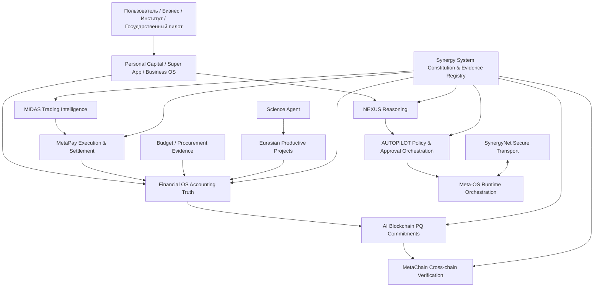

# СИНЕРГИЯ — Regulatory Sandbox / Verifiable Economic Coordination OS

> **Единый master-dossier проекта для регуляторной песочницы, грантов, технологических партнёров и инвесторов.**  
> **Статус:** R&D / pre-production / sandbox proposal  
> **Дата среза:** 6 сентября 2026  
> **Архитектурный корень:** `Shtenco/synergy_system`  
> **Наблюдаемая федерация:** 45 репозиториев  
> **Основатель и системный архитектор:** Евгений Коштенко

---

## 1. Executive summary

**СИНЕРГИЯ** — это проект регуляторной песочницы для проверки новой модели цифровой экономической инфраструктуры, в которой личные финансы, бизнес, институциональные инвестиции, платежи, бухгалтерский учёт, государственные расходы, научные проекты, промышленность, AI-координация и блокчейн-доверие соединяются не через один централизованный «суперсервис», а через **федерацию независимых доменов с чёткими полномочиями, типизированными контрактами и проверяемыми доказательствами**.

Ключевая инженерная идея проекта:

> **один экономический факт → один источник полномочий → одно проверяемое доказательство → воспроизводимый маршрут между системами.**

СИНЕРГИЯ не предполагает, что AI, блокчейн, токен или внутренняя переоценка сами по себе создают экономическую ценность. В новой архитектуре внешняя прибыль признаётся только после внешнего расчёта, бухгалтерская истина принадлежит Financial OS, платёжный расчёт — MetaPay, торговая аналитика — MIDAS, reasoning — NEXUS, а blockchain/metachain фиксируют и проверяют доказательства, но не подменяют бухгалтерию и реальный мир.

Цель песочницы — **доказать или опровергнуть** экономическую, технологическую и регуляторную состоятельность этой модели на ограниченном наборе пилотов до любого масштабирования.

---

## 2. Что именно предлагается проверить в песочнице

СИНЕРГИЯ объединяет шесть прикладных пилотных контуров.

### Pilot A — «Личный капитал»

Не-кастодиальное приложение финансовой дисциплины:

- `Доходы − Расходы = Дельта`;
- бюджетные конверты и цели;
- резерв 3–6 месяцев;
- долговой модуль;
- инвестиционная лестница;
- сценарии сложного процента и финансовой свободы;
- стресс-тестирование бюджета;
- AI-помощник с ограниченными полномочиями и обязательным раскрытием предположений.

**Цель пилота:** измерить изменение нормы сбережений, долговой нагрузки, размера резерва, устойчивости бюджета и качества финансовых решений без обещаний доходности.

### Pilot B — MetaPay + Financial OS

Регулируемый контур расчёта и бухгалтерской истины:

- payment intent;
- authorization;
- funding reservation;
- execution;
- settlement evidence;
- double-entry accounting;
- reconciliation;
- HardNAV / liquidity / liabilities;
- distributable-capacity firewall;
- reversal/compensation вместо переписывания истории.

**Цель пилота:** доказать полный audit trail от намерения до расчёта и бухгалтерского признания.

### Pilot C — MIDAS Institutional Capital Engine

Институциональный исследовательский контур:

- multi-model market intelligence;
- глобальный граф ликвидности;
- capacity/settlement-aware routing;
- OOS / walk-forward / shadow validation;
- учёт комиссий, slippage, market impact и capacity;
- передача только ограниченного `TradingExecutionIntent` в MetaPay;
- признание PnL только после settlement и reconciliation.

**Цель пилота:** проверить наличие устойчивого внешнего edge после всех расходов. До получения требуемых разрешений/партнёра live-торговля клиентскими средствами не является частью песочницы.

### Pilot D — Blockchain Budget / Public Finance Evidence

Контур прозрачности бюджета и закупок:

- федеральный/региональный/муниципальный уровень как модель доменов;
- procurement/payment/delivery evidence;
- Merkle-аудит;
- anomaly detection;
- разграничение MOCK-сценариев и реализованных фактов;
- оценка предотвращённых потерь только по подтверждаемым кейсам.

**Цель пилота:** оценить, насколько сквозная трассировка способна сокращать ошибки, дублирование, задержки и непрозрачные участки закупочного цикла.

### Pilot E — Federation V3 Secure Event Fabric

Инфраструктурный пилот распределённой финансовой системы:

- immutable typed contracts;
- producer/consumer authority;
- signed event envelope;
- post-quantum signature binding;
- transactional outbox/inbox;
- persistent replay ledger;
- at-least-once delivery + idempotent consumption;
- delivery lease/recovery;
- dead-letter/quarantine;
- compensating/reversal flows;
- SynergyNet store-forward transport;
- Meta-OS orchestration без доменной власти.

**Цель пилота:** прогнать одно событие через несколько независимых процессов и репозиториев без потери, двойного применения или скрытой эскалации полномочий.

### Pilot F — Science → Falsification → Industry

R&D pipeline для высокорисковых научных и инженерных направлений:

`Hypothesis → Simulation → Falsification → Experiment → Reproduction → TRL → IP → Commercialization → Industrial Project`

Внутри находятся AI/compute, XPU, фундаментальная физика, LENR/transmutation, software/cybersecurity и иные направления, но **гипотеза никогда не маркируется как научный факт без воспроизводимого экспериментального подтверждения**.

---

## 3. Почему проекту нужна именно регуляторная песочница

СИНЕРГИЯ пересекает несколько регулируемых областей одновременно: платежи, инвестиции, алгоритмическую торговлю, цифровые активы, бухгалтерский учёт, идентификацию, AI-assisted decision making, публичные финансы и cross-border interoperability.

Полноценный запуск «сразу в рынок» создавал бы лишний правовой и операционный риск. Песочница позволяет поэтапно проверить:

1. **технологию** — работают ли контракты, события, reconciliation и recovery;
2. **экономику** — создаётся ли внешняя измеримая ценность после всех расходов;
3. **risk management** — выдерживает ли система отказ, повтор, reorg, reversal, ликвидностный стресс;
4. **compliance** — где требуются KYC/AML, лицензированный партнёр, хранение данных, аудит, human approval;
5. **consumer protection** — нет ли скрытых гарантий доходности, неверной классификации риска или смешения клиентских и собственных средств;
6. **масштабируемость** — можно ли перейти от одного узкого пилота к междоменной федерации.

### Базовый sandbox perimeter

На первом этапе по умолчанию используются synthetic/mock funds, testnet, paper/shadow execution и ограниченные данные. Любая операция с реальными клиентскими средствами, публичным привлечением капитала, выпуском регулируемого инструмента или внешним платёжным исполнением включается только через соответствующий правовой режим и/или лицензированного партнёра.

---

## 4. Архитектура



### Главный принцип

**Федерация, а не монолит.** Каждый домен отвечает только за свой тип истины.

| Факт / полномочие | Канонический владелец |
|---|---|
| Архитектура, конституция, registry, release evidence | `synergy_system` |
| Runtime/service orchestration | `synergy_meta_os` |
| P2P transport | `synergynet` |
| Reasoning | `agi_nexus` |
| Action/policy orchestration | `agi_autopilot` |
| Торговая аналитика | `midas_ai` |
| Платёжное исполнение и settlement | `synergy_pay_system` |
| Бухгалтерская истина / HardNAV | `synergy_financial_os` |
| PQ chain commitments | `synergy_ai_blockchain` |
| Cross-chain verification | `synergy_metachain` |
| Государственная бюджетная трассировка | `blochain_budget` |
| Household capital product | `synergy_app` |
| Productive projects / industry / regions | `synergy_eurasian` |
| Science research orchestration | `nexus_science_agent` |

---

## 5. Federation V3 Secure Event Fabric

После Contracts V1 проект перешёл от «типизированных связей» к durable event architecture.

```text
Validated Contract
      ↓
Signed Immutable Event Envelope
      ↓
Transactional Outbox
      ↓
SynergyNet Store-Forward Transport
      ↓
Persistent Inbox + Replay Ledger
      ↓
Domain Consumer
      ↓
ACK / Retry / DLQ / Quarantine / Compensation
```

### Инварианты

- `at-least-once delivery + idempotent consumer`, без ложного обещания exactly-once;
- один `contract_id` нельзя переиспользовать с другим payload hash/type/route;
- retry не меняет подписанный economic fact;
- original contract не переписывается при reversal;
- payment truth и accounting truth коммитятся вместе с outbox event в одной локальной транзакции;
- transport не имеет финансовой власти;
- Meta-OS не имеет payment/accounting/execution authority;
- blockchain не переоценивает финансовое состояние.

### PQ-security

В trust-layer реализуется binding событий к post-quantum signature provider. Primary R&D profile — ML-DSA; SLH-DSA рассматривается как более тяжёлый резервный профиль. Production key custody должен находиться в отдельном HSM/KMS/key-registry boundary; process-local ключ не считается production custody.

---

## 6. Экономическая модель: от внутренней метрики к внешней ценности

Ключевой firewall проекта:

> **No external settlement ⇒ no external profit.**

Не считаются внешней прибылью:

- mint/rebase;
- внутренняя переоценка токена;
- перенос средств между собственными счетами;
- flash-loan principal;
- внутренний accounting mark;
- новый участник или его вступительный платёж;
- backtest без OOS/стоимости/capacity;
- сценарный AI uplift;
- непроверенная научная гипотеза.

### Canonical value chain

`real demand → verified transaction/project → settlement → reconciliation → recognized revenue/PnL → reserves/liabilities → distributable capacity → reinvestment`

Это позволяет использовать проект как экспериментальную инфраструктуру для фонда развития и производственных программ, не смешивая «ожидаемую ценность» с уже заработанными деньгами.

---

## 7. Продуктовые домены

### 7.1 Personal Capital

Формула происхождения проекта:

`Income − Expenses = Delta → Investment → Assets → Net Capital → Financial Freedom`

Современная версия добавляет reserve/debt/stress/scenario engines и запрещает guaranteed-return language.

### 7.2 Business / Growth OS

Исторические network/franchise/referral идеи сохранены только там, где вознаграждение связано с **реальной продажей или доказуемым экономическим вкладом**.

`recruitment ≠ revenue`

### 7.3 Development Fund / Financial OS

Фонд трактуется как регулируемый capital-allocation/accounting контур:

- liquidity buckets;
- liabilities;
- reserves;
- project allocations;
- realized external PnL;
- distributable capacity;
- stress scenarios;
- audit trail.

### 7.4 MetaPay

Платёжный слой отделяет:

- unit of account;
- payment asset;
- reserve asset;
- risk/growth asset.

### 7.5 MIDAS

MIDAS — не «машина гарантированной доходности», а исследовательско-институциональный intelligence layer с обязательными OOS, costs, capacity, shadow/live evidence и settlement-backed PnL.

### 7.6 Budget Blockchain

Блокчейн используется как доказательный слой для бюджетных/закупочных событий, но не как замена первичным документам, казначейству или бухгалтерии.

### 7.7 Science & Industry

Научные результаты проходят falsification/reproduction gates до передачи в productive-project model.

---

## 8. Текущий engineering status

Проект уже содержит не только концепцию, но и работающие/тестируемые элементы. При этом **production-ready статус не заявляется**.

| Контур | Текущий статус на 06.09.2026 |
|---|---|
| Federation V3 map / 45 repos / authority model | implemented candidate, open federation PRs |
| Contracts V1 | typed schemas + runtime types + negative tests, stacked PR |
| Secure Event Fabric | durable outbox/inbox/replay/DLQ/quarantine/lease recovery implemented in candidate branch |
| SynergyNet | durable opaque store-forward transport candidate |
| Meta-OS | persistent routing/replay state candidate |
| MetaPay | settlement domain + transactional outbox candidate |
| Financial OS | accounting/HardNAV contracts + transactional outbox candidate |
| AI Blockchain | typed commitments + PQ signer R&D candidate |
| MetaChain | finality/light-client/bridge-proof contract layer candidate |
| MIDAS | canonical institutional trading-intelligence target + large R&D lineage |
| NEXUS / AUTOPILOT | bounded reasoning/action orchestration R&D |
| Personal Capital | canonical product target |
| Budget | public-finance traceability target |
| Science Agent | hypothesis→falsification→TRL→commercialization target |
| XPU / TURBO | compute/host R&D |

### Честный текущий барьер

Центральный reference E2E уже описывает цепочку:

`MIDAS → MetaPay → Financial OS → Blockchain → MetaChain`

Следующий доказательный рубеж — **literal multi-repo/multi-process E2E**, в котором native checkout каждого домена действительно участвует в одном сквозном событии. До этого проект корректно классифицируется как pre-production/sandbox R&D, а не как готовая финансовая инфраструктура.

---

## 9. 45-repository federation

<details>
<summary><b>Показать полную карту репозиториев</b></summary>

### Canonical / target domains

- `Shtenco/synergy_system` — architecture governance / constitution / evidence registry
- `Shtenco/synergy_meta_os` — runtime orchestration
- `Shtenco/synergynet` — P2P evidence transport
- `Shtenco/agi_nexus` — bounded reasoning
- `Shtenco/agi_autopilot` — bounded action orchestration
- `Shtenco/nexus_science_agent` — science workflow
- `Shtenco/synergy_financial_os` — accounting truth / HardNAV
- `Shtenco/synergy_pay_system` — payment execution / settlement
- `Shtenco/midas_ai` — trading intelligence
- `Shtenco/synergy_eurasian` — productive economy / regions / industry
- `Shtenco/synergy_app` — Personal Capital product
- `Shtenco/synergy_matrix_sota` — household capital model
- `Shtenco/synergy_ai_blockchain` — PQ blockchain trust
- `Shtenco/synergy_metachain` — cross-chain verification
- `Shtenco/blochain_budget` — state budget/procurement traceability
- `Shtenco/synergychain` — Business/Growth OS
- `Shtenco/ai_language` — semantic requirements/contracts
- `Shtenco/ai_coder` — engineering change evidence
- `Shtenco/ai_compress` — compression/archive
- `Shtenco/turbo_linux` — host/runtime R&D
- `Shtenco/motherboard_xpu_xml` — compiled-graph compute R&D

### Trading / market R&D lineage

- `Shtenco/midas_ai_trading_system`
- `Shtenco/midas_lite`
- `Shtenco/ai_trade_terminal`
- `Shtenco/algotrading_graph_system`
- `Shtenco/quantum-trading_metatrader5`
- `Shtenco/computer_vision_trading_metatrader_5`
- `Shtenco/swap_arbitrage_metatrader_5`
- `Shtenco/cross_forex_arbitrage_trading_metatrader_5`
- `Shtenco/global_liquidity_dataminer`
- `Shtenco/3D_bars_market_structure`
- `Shtenco/multi_threaded_trading_robot_with_machine_learning_python`

### Monetary / financial falsification R&D

- `Shtenco/ai_financial_system`
- `Shtenco/usds`
- `Shtenco/cashero`
- `Shtenco/print_money_synergychain`

### Science / AI / data R&D

- `Shtenco/binary_quantum_theory`
- `Shtenco/cold_nuclear`
- `Shtenco/agi_olga`
- `Shtenco/qr_compress`

### Client / presentation / provenance

- `Shtenco/sinergy-super-app`
- `Shtenco/sinergy_app`
- `Shtenco/synergychain.github.io`
- `Shtenco/shtenco.github.io`
- `Shtenco/shtencoauantai.github.io`

</details>

---

## 10. Regulatory & compliance-by-design

Песочница строится fail-closed: отсутствие доказательства не интерпретируется как разрешение.

### Контрольные области

- KYC/KYB и AML/CFT при подключении реального платёжного/инвестиционного контура;
- segregation собственных и клиентских средств;
- human/multisig approval для критических действий;
- suitability/risk disclosure для инвестиционных функций;
- model risk management и audit trail для AI;
- data minimization, consent, retention и access control;
- incident response, rollback, key rotation/revocation;
- независимый security review до production;
- лицензированный broker/payment/custody partner там, где это требуется;
- запрет гарантированных доходностей и скрытого инвестиционного маркетинга;
- маркировка `MOCK`, `SCENARIO`, `SHADOW`, `LIVE_SETTLED` как разных уровней доказательности.

### AI authority boundary

AI может:

- анализировать;
- предлагать;
- ранжировать;
- симулировать;
- обнаруживать аномалии;
- строить policy-compliant action request.

AI по умолчанию не может самостоятельно:

- признать бухгалтерскую прибыль;
- подписать платёж;
- распоряжаться клиентскими активами;
- изменить authority policy;
- объявить научную гипотезу доказанной;
- повысить систему до production-ready.

---

## 11. План песочницы: 18 месяцев

### Phase 0 — Regulatory design / 0–2 месяца

- выбрать юрисдикцию и sandbox perimeter;
- legal mapping каждого пилота;
- data classification;
- threat model;
- KPI baseline;
- partner roles;
- freeze Contracts/Secure Event protocol version.

### Phase 1 — Closed technical sandbox / 2–6 месяцев

- synthetic funds / testnet;
- literal multi-repo E2E;
- persistent key registry;
- PQ public-key rotation/revocation;
- failure injection;
- reconciliation/reversal tests;
- regulator/auditor read-only dashboard.

### Phase 2 — Controlled pilot / 6–12 месяцев

- ограниченная группа пользователей/организаций;
- non-custodial Personal Capital;
- shadow MIDAS;
- sandbox MetaPay settlement через партнёра либо модельные rails;
- procurement/budget pilot на тестовом наборе;
- security and model-risk audit.

### Phase 3 — Evidence-backed expansion / 12–18 месяцев

- сравнение KPI с baseline/control;
- переход только тех модулей, которые прошли gates;
- limited live-settled transactions при наличии правового основания;
- commercialization package;
- production architecture decision.

---

## 12. KPI песочницы

### Technology

- 0 потерянных committed events;
- 0 двойных domain effects при повторной доставке;
- 100% detect для conflicting replay в тестовом корпусе;
- recovery после worker/process crash;
- доля E2E flows с полной provenance chain;
- RTO/RPO по каждому authority domain.

### Finance & accounting

- 100% live PnL подтверждается settlement + reconciliation;
- `HardNAV delta = reconciled external economic result` для MATCHED операций;
- 0 distributable capacity сверх проверенных ограничений;
- прозрачный liquidity/reserve coverage.

### Consumer

- изменение savings rate;
- изменение reserve months;
- изменение debt-service burden;
- доля пользователей, понимающих risk disclosure;
- жалобы/ошибочные рекомендации/override rate.

### Public finance

- доля полностью трассируемых закупочных кейсов;
- время аудита;
- число доказанных, а не модельных аномалий;
- подтверждённый предотвращённый/возвращённый ущерб.

### AI

- selective-answer accuracy;
- UNKNOWN/abstention quality;
- provenance completeness;
- false-positive/false-negative rate;
- human override rate;
- запрещённые authority escalation attempts = 0 accepted.

### Science/industry

- hypotheses falsified/validated;
- reproducible experiments;
- TRL transitions;
- patents/IP artifacts;
- industrial pilots;
- external revenue created by commercialized project.

---

## 13. Business model после песочницы

СИНЕРГИЯ проектируется не как один потребительский продукт, а как platform/federation с несколькими моделями монетизации:

1. **B2C SaaS** — Personal Capital / premium financial planning;
2. **B2B SaaS/API** — Financial OS, Business/Growth OS, audit/evidence APIs;
3. **B2B2C infrastructure** — MetaPay/settlement orchestration через лицензированных партнёров;
4. **Institutional licensing** — MIDAS analytics/risk/portfolio tooling;
5. **GovTech** — budget/procurement traceability and anomaly analytics;
6. **Enterprise federation** — Secure Event Fabric / evidence infrastructure;
7. **R&D commercialization** — licensing, spin-outs, IP and industrial projects.

Доходность инвестиционных/торговых модулей не является гарантированным источником выручки проекта и должна подтверждаться отдельно.

---

## 14. Запрос к грантодателю / инвестору / регулятору

Проект ищет три типа партнёров.

### 1. Регуляторный/институциональный партнёр

Нужен для определения sandbox perimeter, compliance requirements, наблюдения за KPI и допуска к ограниченному реальному пилоту.

### 2. Грантовый партнёр

Финансирование применяется к измеримым deliverables: security, E2E infrastructure, audit tooling, public-finance pilot, science-to-industry pipeline, reproducibility and independent validation.

### 3. Стратегический/венчурный инвестор

Капитал направляется на превращение отдельных доказанных sandbox-модулей в коммерческие продукты, а не на финансирование неподтверждённых обещаний.

### Предлагаемое распределение проектного бюджета

- **30%** — engineering / multi-repo E2E / reliability;
- **20%** — compliance, legal design, security audit;
- **15%** — pilot infrastructure / data / test environments;
- **15%** — productization and UX;
- **10%** — independent validation / scientific reproducibility;
- **10%** — commercialization, IP, partner integrations.

Конкретная сумма и структура инструмента определяются под требования выбранной грантовой программы, sandbox и инвестора.

---

## 15. Milestone-based financing

Предлагается финансировать не «видение целиком», а доказательные этапы.

| Gate | Результат | Следующий капитал открывается если… |
|---|---|---|
| G0 | architecture & legal perimeter | утверждены полномочия, KPI и риски |
| G1 | closed E2E sandbox | native multi-process trace воспроизводим |
| G2 | security/compliance validation | нет критических нерешённых findings |
| G3 | controlled pilot | KPI показывают измеримый эффект |
| G4 | limited live-settled | экономические результаты подтверждены settlement/accounting |
| G5 | commercialization | существует доказанный buyer/use-case и unit economics |

Такой подход снижает capital-at-risk и для инвестора, и для государства.

---

## 16. Основные риски и их снижение

| Риск | Митигирующий механизм |
|---|---|
| Слишком широкий scope | песочница разбита на независимые pilots/gates |
| Регуляторная неопределённость | sandbox-first + licensed partners |
| Финансовая иллюзия из внутренних метрик | HardNAV + external settlement firewall |
| Model overfit | OOS/walk-forward/shadow/live evidence |
| AI authority creep | explicit authority registry + negative tests |
| Event duplication/loss | outbox/inbox + replay ledger + idempotency |
| Key compromise | PQ provider boundary + rotation/revocation + future HSM/KMS |
| Blockchain treated as truth oracle | blockchain = commitment layer only |
| Scientific overclaim | falsification + reproduction + TRL gates |
| Network/MLM risk | recruitment-funded economics explicitly rejected |
| Exponential-growth narratives | capacity/saturation/system-dynamics models |
| Multi-repo complexity | typed contracts + federation root + evidence registry |

---

## 17. Историческое происхождение и модернизация

Концептуальная линия проекта началась в 2018 году как идея объединения личного капитала, консорциума, общего фонда, науки, промышленности, AI и цифровой валютно-платёжной системы. К 2025 году она была описана как многоуровневая интегрированная модель.

Federation V3 сохраняет полезное ядро — обратные связи, кооперацию, длинный горизонт, связь науки с промышленностью и финансовой дисциплиной — но **не переносит исторические предположения как доказанные факты**.

### Не являются канонической истиной

- гарантированные инвестиционные доходности;
- фиксированные AI uplift проценты;
- безусловный экспоненциальный рост;
- recruitment-funded economics;
- внутренняя стоимость токена как внешнее богатство;
- непроверенные научные утверждения;
- blockchain как бухгалтерская власть;
- AI как неограниченная исполнительная власть.

Они могут существовать только как `HYPOTHESIS`, `SCENARIO` или `R&D` и должны заново подтверждаться экспериментом.

---

## 18. Research tracks

### Financial/market

- capacitated global liquidity graph;
- multi-venue FX routing;
- market making;
- settlement-aware arbitrage;
- portfolio/risk intelligence;
- AMM/QE/QT/MEV falsification experiments.

### AI

- bounded NEXUS reasoning;
- typed graph semantics;
- explicit UNKNOWN;
- provenance-aware answers;
- policy/action orchestration;
- semantic requirement language;
- AI engineering/change evidence.

### Trust/security

- ML-DSA/SLH-DSA profiles;
- signed contract envelopes;
- durable secure event transport;
- cross-chain finality/light-client verification;
- offline/QR evidence payloads.

### Compute

- TURBO host/runtime;
- compiled-graph XPU;
- global wavefront placement;
- compression/dedup/content-addressed archive.

### Science

- fundamental mathematical/physical models;
- LENR/transmutation as falsifiable hypothesis;
- reproducible experiment pipeline;
- science→IP→industry traceability.

---

## 19. IP and commercialization strategy

Каждый R&D результат должен иметь:

- provenance;
- authorship;
- prior-art review;
- reproducibility evidence;
- TRL;
- patentability assessment;
- licensing/spin-out/manufacturing path;
- target-market and jurisdiction strategy.

Патентная заявка сама по себе не считается доказательством научной или коммерческой состоятельности.

---

## 20. Definition of success

Песочница считается успешной не тогда, когда «вся СИНЕРГИЯ запущена», а когда несколько независимых гипотез проходят проверку:

1. федеративная архитектура выдерживает реальные отказные сценарии;
2. финансовые факты невозможно повысить до прибыли без settlement/accounting evidence;
3. AI остаётся в пределах объявленных полномочий;
4. пользовательский финансовый продукт создаёт измеримое улучшение поведения;
5. public-finance traceability сокращает стоимость/время контроля;
6. хотя бы один R&D/science проект проходит воспроизводимый путь до промышленного пилота;
7. возникает коммерческий спрос на отдельные модули без необходимости продавать всю систему как один мегапроект.

---

## 21. Release / evidence vocabulary

Проект использует единый ladder:

`CONCEPT → IMPLEMENTED → TESTS_PRESENT → RUNNER_EXECUTED → VERIFIED → SHADOW → LIVE_SETTLED → PRODUCTION_READY`

И единый status vocabulary:

`CANONICAL / CANDIDATE / R&D / LEGACY / ARCHIVE / PRESENTATION / PLACEHOLDER`

**Ни один нижний статус не должен маркетироваться как более высокий.**

---

## 22. Для грантового/инвестиционного due diligence

По запросу могут быть предоставлены:

- federation manifest и authority graph;
- schema/contracts registry;
- PR/commit evidence по каждому модулю;
- E2E protocol DAG;
- test and failure-injection evidence;
- threat model;
- regulatory mapping;
- model cards / OOS evidence для MIDAS;
- HardNAV/reconciliation invariants;
- public-finance mock/pilot datasets;
- science falsification protocols;
- roadmap, budget and milestone plan;
- IP register.

---

## 23. Контакт и участие

**Project:** SYNERGY Regulatory Sandbox  
**Founder / Systems Architect:** Евгений Коштенко  
**GitHub:** `Shtenco`  
**Master repository:** `Shtenco/synergy_project`

Ищем регуляторных, банковских, брокерских, GovTech, industrial, academic, security и investment партнёров для ограниченных доказательных пилотов.

---

## Disclaimer

Этот репозиторий описывает исследовательскую и проектную архитектуру. Он не является публичной офертой, обещанием доходности, инвестиционной рекомендацией, банковской/брокерской/платёжной лицензией или утверждением о доказанности экспериментальных научных гипотез. Любые regulated/live функции должны запускаться только в разрешённом правовом контуре и после прохождения соответствующих evidence gates.
